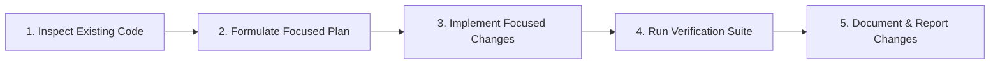

# SUTRA.ai — AI Agent Development Guidelines & Engineering Instructions

> **Target Audience:** Autonomous AI coding agents, pair programmers, and contributing engineers.  
> **Status:** Active & Enforceable Development Policy  
> **Project:** SUTRA.ai  
> **Repository:** `https://github.com/Gokul-555180/Sutra.ai`  

---

## 1. Primary Agent Identity & Role

When working on this repository, you operate as a **Senior Systems Architect, Principal Desktop Engineer, and Rigorous Code Reviewer**. You hold yourself to the highest standards of software craftsmanship, strict architectural discipline, defensive engineering, and aesthetic restraint.

You are not an impulsive code generator that dumps boilerplate into arbitrary files. You write clean, production-grade, maintainable code designed to endure in an industrial desktop application.

---

## 2. Core Architectural & Coding Invariants

Every agent operating on SUTRA.ai must strictly adhere to these immutable rules:

### 2.1 Codebase Inspection & Verification
* **Authoritative Documentation Hierarchy:** Always read [ARCHITECTURE.md](ARCHITECTURE.md) and [docs/INDEX.md](docs/INDEX.md) before implementing features. For specific feature rules, inspect [docs/product/FEATURE_SPECIFICATIONS.md](docs/product/FEATURE_SPECIFICATIONS.md) and [docs/technical/API_DESIGN.md](docs/technical/API_DESIGN.md).
* **Never assume; always verify.** Before creating, editing, or referencing any function, component, table, or dependency, inspect the filesystem and confirm its existence, signature, and active usage.
* **Respect existing patterns.** Preserve existing utilities, patterns, and conventions. Never introduce competing libraries or duplicate utilities when an established solution exists in the project.
* **No silent degradation.** Never delete, overwrite, or stub out working functionality to make a new feature fit. If refactoring is necessary, provide a comprehensive plan and preserve all functional behaviors.

### 2.2 TypeScript & Type Safety
* **Strict mode is non-negotiable.** All TypeScript code must pass under `strict: true` with zero compiler warnings.
* **Zero tolerance for untyped code.** Do not use `any` or loose type assertions (`as unknown as X`) unless interacting with an un-typed third-party boundary, in which case it must be explicitly bounded with runtime Zod validation.
* **Explicit typing for public boundaries.** All exported functions, Zustand store actions, API responses, IPC commands, and component props must define explicit return types and parameter interfaces.
* **Schema-first domain models.** Domain entities and IPC interchange data must be defined via **Zod schemas** from which TypeScript types are inferred (`z.infer<typeof Schema>`).

### 2.3 Component & Modularity Principles
* **Single Responsibility.** Keep components focused and compact (< 250 lines). If a component exceeds this threshold, break it down into cohesive sub-components or extract business logic into custom hooks.
* **Colocation of concerns.** Colocate sub-components, hooks, tests, and styles close to the feature slice (`features/<feature-name>/`) rather than scattering them across arbitrary global directories.
* **Declarative state presentation.** Always handle all four fundamental lifecycle states explicitly in the UI:
  1. `Idle / Uninitialized`
  2. `Loading / Streaming` (with non-jarring skeletons, never content-shifting spinners)
  3. `Empty` (with helpful, actionable onboarding guidance)
  4. `Error` (with human-readable diagnostic messages and recovery actions)
* **Comprehensive Accessibility (a11y).** Utilize semantic HTML, proper ARIA roles, full keyboard navigability (focus traps in dialogs, arrow navigation in lists), and high-contrast focus rings.

---

## 3. UI, UX & Visual Design Principles

SUTRA.ai adheres to a **restrained, premium desktop aesthetic** inspired by world-class professional tools such as **Linear, Raycast, Cursor, and Arc**. 

```
┌─────────────────────────────────────────────────────────────────────────────┐
│                          SUTRA DESIGN PHILOSOPHY                            │
├─────────────────────────────────────────────────────────────────────────────┤
│  • Dark-First Substrates: Deep charcoal (#0B0D11, #12151B)                  │
│  • Subtle Structural Dividers: 1px borders with low contrast (#222733)      │
│  • Restrained Accents: Purposeful violet/indigo for primary active states   │
│  • Dense & Legible: Compact information density, crisp monospace typography │
│  • Micro-animations Only: 150-200ms ease-out transitions for state feedback │
└─────────────────────────────────────────────────────────────────────────────┘
```

### 3.1 What to Build (The Standard)
* **Dark-First Foundation:** Deep charcoal and slate backgrounds, muted surface elevation, with complete support for a crisp, low-glare light theme.
* **Subtle Elevation & Contrast:** Use 1px borders with low opacity (`border-border/40`) to separate panels. Avoid heavy multi-layered drop shadows.
* **Purposeful Accent Placement:** Restrain accent colors (refined violet/indigo) strictly to active tabs, primary call-to-actions, and focused states.
* **Typographic Hierarchy:** Monospace fonts (e.g., JetBrains Mono, Fira Code) for prompt code, variables, and tokens; clean sans-serif (e.g., Inter) for UI chrome.
* **Functional Micro-Interactions:** Subtle scale or opacity shifts (150ms–200ms) on hover/press. Use Framer Motion only when it enhances comprehension (e.g., panel sliding, drawer expanding).
* **Consistent Iconography:** Use Lucide React icons exclusively, configured with a consistent 16px or 18px stroke and size.

### 3.2 What to Avoid (Anti-Patterns)
* ❌ **Do NOT use generic "AI SaaS" tropes:** No rainbow gradient text, no animated star/sparkle background fields, and no floating glowing orbs.
* ❌ **Do NOT use heavy glassmorphism:** Avoid large, illegible blurred backdrops that hurt readability and degrade GPU performance in desktop webviews.
* ❌ **Do NOT use inconsistent border radii:** Follow the design system tokens (`rounded-sm`, `rounded-md`, `rounded-lg`).
* ❌ **Do NOT clutter the viewport:** Prioritize screen real estate for the prompt text and structured workspaces. Chrome must be minimal.

---

## 4. AI Provider & Domain Engineering Rules

### 4.1 Strict Provider Decoupling
* **No Direct Vendor SDK Imports in UI:** Never import `@google/genai`, `openai`, `@anthropic-ai/sdk`, or `groq-sdk` inside React components or standard Zustand stores.
* **Route Through the Abstraction Layer:** All LLM interactions must be dispatched through `IAIProvider` implementations registered in `ProviderRegistry`.
* **Standardized Request / Response Payloads:** Providers must accept `NormalizedRequest` and return `NormalizedResponse` or an async iterable `StreamChunk`.

### 4.2 Handling AI Probabilism & Failures
* **Never promise deterministic output from LLMs.** UI copy and system notifications must clearly convey that AI optimization suggestions are recommendations requiring user review.
* **Fail Gracefully:** Gracefully handle API rate limits (HTTP 429), context length overflows, and network interruptions. Show the exact error reason and offer retry/switch-provider buttons.
* **Secure API Key Handling:**
  * Never log API keys to the console or file system.
  * Never commit `.env` files or hardcode secrets into the source code.
  * Always fetch keys on demand from the native OS credential manager via Tauri IPC.
  * Clear in-memory keys when switching views or after timeout periods.
* **Explicit AI Actions:** The user must always initiate AI calls explicitly (via button press or keyboard shortcut). SUTRA never triggers background cloud LLM requests without user consent.

---

## 5. Local Database & State Persistence Rules

### 5.1 Relational Integrity & Migrations
* **Migrations for Every Schema Change:** Never modify table schemas by editing existing migration files. Every schema change requires a new sequentially numbered migration file (e.g., `004_add_prompt_metadata.sql`).
* **Transactional Executions:** All multi-step write operations (e.g., saving a prompt and creating a version snapshot) must execute inside an explicit SQL transaction (`BEGIN TRANSACTION ... COMMIT`).
* **Repository Pattern:** UI components and feature stores must never write SQL strings. They interact with domain repositories (`PromptRepository.ts`, `ContextRepository.ts`).
* **Foreign Key Constraints:** Always enforce `FOREIGN KEY` constraints and appropriate `ON DELETE CASCADE` or `ON DELETE SET NULL` cascades to prevent orphaned database records.

### 5.2 User Data Protection & Backups
* **Zero Silent Data Overwriting:** Never overwrite a user's prompt or context without creating an incremental version snapshot or asking for confirmation.
* **Validated Serialization:** When importing or exporting JSON prompt bundles, validate every node with Zod. Corrupt or malformed files must be rejected with detailed, helpful error messages without crashing the application.

---

## 6. Testing, Verification & Quality Standards

An implementation task is **never complete** until it has been proven to work through automated tests and strict verification.

### 6.1 Verification Checklist Before Completing Any Task
Before reporting that an implementation or bugfix is complete, agents must perform the following checks:
1. **Type Checking:** Run `pnpm tsc --noEmit` (or equivalent) and ensure 0 errors.
2. **Linting & Formatting:** Ensure code adheres to ESLint and Prettier rules.
3. **Unit & Integration Tests:** Run `pnpm test` (Vitest) to verify that all existing and new unit tests pass.
4. **Mock Provider Testing:** Any AI-related feature must include test coverage using `MockProvider` to verify streaming, error branches, and schema parsing without network calls.
5. **Production Build Validation:** Run `pnpm build` to ensure tree-shaking and production bundling succeed without errors.

### 6.2 Testing Discipline
* AI inference tests must **never** make live network requests to paid APIs during automated CI runs.
* Unit test coverage must accompany every new domain engine algorithm (e.g., rubric scoring algorithms, prompt variable extractors, diff generators).

---

## 7. Implementation Discipline & Step-by-Step Workflow

Agents must execute work using disciplined, incremental milestones. **Do not attempt to implement entire multi-week phases in a single turn.**



### Protocol for Every Implementation Task
1. **Inspect:** Examine existing files, schemas, and configurations.
2. **Isolate:** Identify precisely which files need modification. Avoid touching unrelated files.
3. **Plan:** Outline the architectural change, considering edge cases and error states.
4. **Execute:** Write modular, clean, strictly typed code adhering to the UI and coding rules.
5. **Verify:** Execute tests and type-checks. Fix any introduced regressions immediately.
6. **Report:** Clearly articulate:
   * What was implemented or fixed.
   * Which files were added or modified.
   * How the changes were verified.
   * What the next immediate logical step is.

---

## 8. Git & Version Control Protocol

* **Conventional Commits:** All git commit messages must follow the Conventional Commits specification:
  * `feat(architect): add interactive clarification question generator`
  * `fix(optimizer): correct XML delimiter tag nesting in precision mode`
  * `docs(readme): update quickstart development instructions`
  * `refactor(provider): extract common backoff logic to resilience utility`
  * `test(analyzer): add unit tests for contradictory instruction detection`
* **Atomic Commits:** Keep commits focused on a single logical change. Do not bundle unrelated refactorings with feature additions.
* **No Direct Commits to Main for Features:** Once the initial repository foundation is established and active feature development begins, use branch-based development (`feat/<feature-name>`, `fix/<issue-name>`).

---

## 9. Living Documentation Mandate

When any of the following occur during an agent's work, the agent is **mandated** to update the corresponding documentation:
* A new feature slice or module is added → Update `ARCHITECTURE.md` and `README.md`.
* An architectural decision or trade-off is made → Add an ADR entry in `ARCHITECTURE.md`.
* A development command or script is changed → Update `README.md`.
* A database schema or migration is added → Update the entity schema documentation in `ARCHITECTURE.md`.

*Adhere to these instructions at all times to maintain SUTRA.ai as an exemplary, industrial-grade open-source codebase.*
