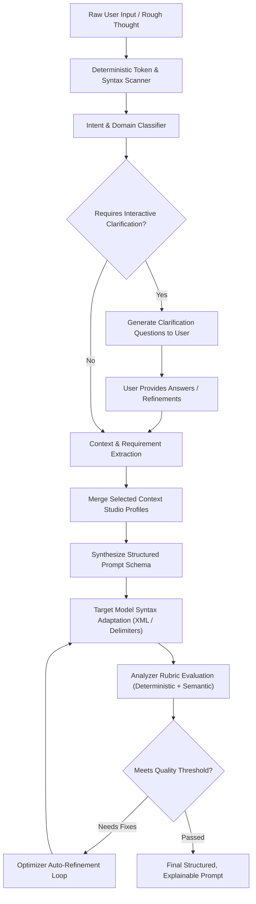
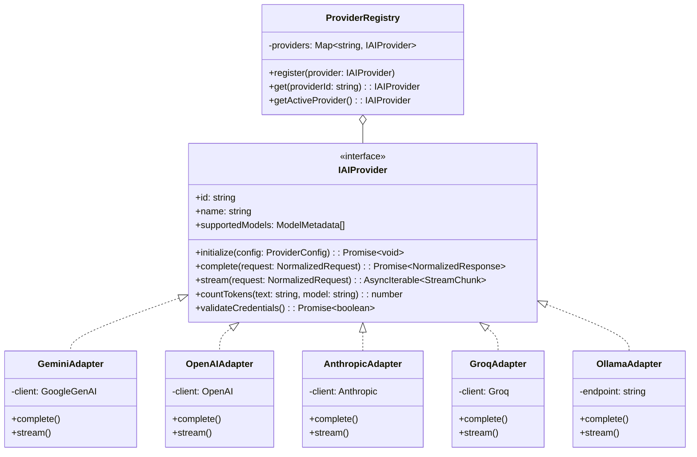
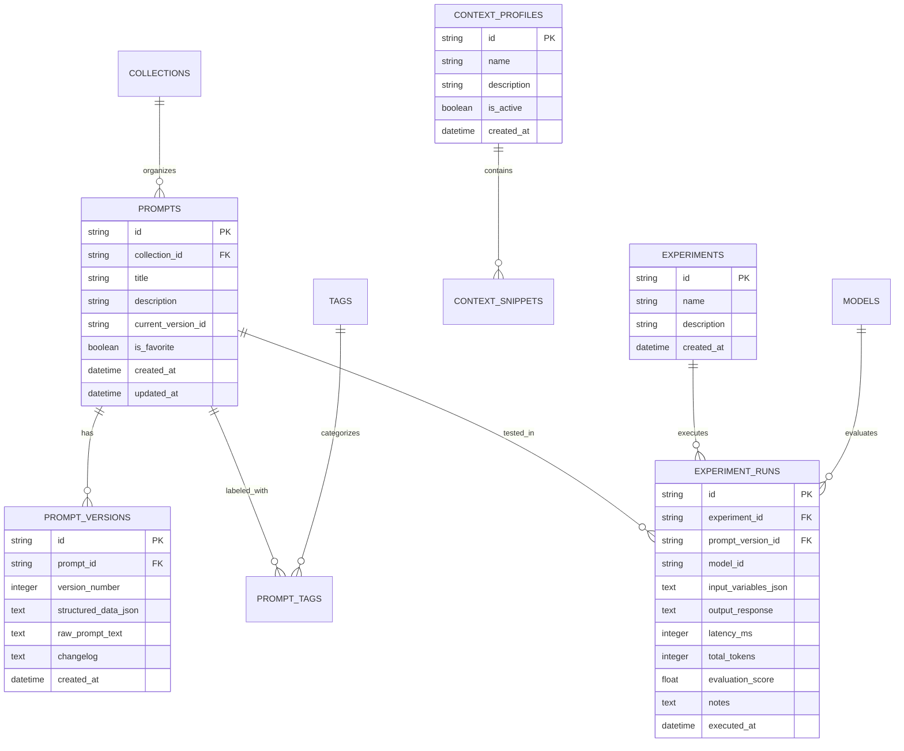

# SUTRA.ai — Technical Architecture Specification

> **Document Version:** 1.0.0  
> **Status:** Foundational Architecture (Pre-Implementation)  
> **Product Name:** SUTRA.ai  
> **Tagline:** *"Where thoughts become instructions."*  
> **Target Platform:** Desktop (Windows, macOS, Linux)  
> **Core Framework:** Tauri 2 (Rust) + React 18+ (TypeScript) + Vite  

---

## 1. Executive Overview & Product Vision

### 1.1 The Meaning of Sutra
Originating from the Sanskrit word सूत्र (*sūtra*), meaning a "thread", "aphorism", "rule", or "concise guiding principle", **SUTRA.ai** embodies the philosophy of distilling unstructured human thoughts, rough goals, and fragmented requirements into clear, structured, and high-performance instructions for Artificial Intelligence models.

In traditional literature, a sutra encapsulates profound wisdom within the fewest possible words without sacrificing clarity. In modern AI engineering, a prompt performs the exact same role: it serves as the instructional genome that directs probabilistic foundation models toward deterministic, reliable, and exceptional outcomes.

### 1.2 Product Vision
Modern generative AI workflows suffer from a fundamental mismatch: human cognition is iterative, contextual, and associative, whereas Large Language Models (LLMs) operate on structured attention mechanisms conditioned strictly on token context windows. Most users either under-specify prompts (leading to generic hallucinations) or over-specify without structure (leading to instruction dilution and context confusion).

**SUTRA.ai** is not a superficial prompt wrapper, "prompt generator", or gimmick library. It is an industrial-grade, **local-first Desktop Prompt Engineering Environment (PEE)**. SUTRA.ai bridges the gap between casual prompting and disciplined software engineering by providing:
1. **Systematic Construction:** Turning conversational thoughts into modular, role-bounded, constraint-governed prompts.
2. **Transparent Optimization:** Transforming and adapting prompts across specialized modes with clear explanations for every added keyword, modified delimiter, or restructured constraint.
3. **Objective Evaluation:** Scoring prompts against rigorous, multi-dimensional rubrics rather than black-box hand-waving.
4. **Empirical Benchmarking:** Running head-to-head experiments across diverse model families (both local and cloud-hosted).
5. **Private Workspace Management:** Preserving all prompts, context profiles, variables, and experiment histories entirely on the user's physical machine.

---

## 2. Core Architectural Principles

SUTRA.ai adheres to eight foundational architectural tenets:

```
┌─────────────────────────────────────────────────────────────────────────────┐
│                       SUTRA.AI ARCHITECTURAL PILLARS                        │
├─────────────────────┬─────────────────────┬─────────────────────────────────┤
│ 1. Local-First Core │ 2. Provider Agnostic│ 3. Explainable AI Optimizations │
├─────────────────────┼─────────────────────┼─────────────────────────────────┤
│ 4. Zero Mandatory   │ 5. Hybrid Reasoning │ 6. Defense-in-Depth Security    │
│    Subscriptions    │    (Rules + LLM)    │    (Keychain + Restrictive IPC) │
├─────────────────────┼─────────────────────┼─────────────────────────────────┤
│ 7. Restrained UI    │ 8. Non-Blocking I/O │ 9. Zero Silent Data Mutation    │
│    Aesthetics       │    & Responsiveness │                                 │
└─────────────────────┴─────────────────────┴─────────────────────────────────┘
```

1. **Local-First Data Ownership:** All prompts, collections, experiment histories, context profiles, and configurations reside in an encrypted/local SQLite database on the client machine. The core application functions 100% offline without any dependency on external servers.
2. **AI Provider Independence:** The core application contains zero vendor-locked prompt logic. A normalized Provider Abstraction Layer isolates the UI and Domain logic from Google Gemini, OpenAI, Anthropic, Groq, and local Ollama instances.
3. **Explainable Prompt Optimization:** Every automated optimization or restructuring must provide a human-readable delta: *what* changed, *why* it changed, and *which prompt engineering principle* justified the modification.
4. **Free Core Experience:** No paywalls, forced logins, or SaaS dependencies for local prompt authoring, structuring, evaluation heuristics, and local model inference. Cloud AI usage relies on user-provided API keys or self-hosted endpoints.
5. **Hybrid Intelligence (Deterministic Heuristics + LLM Synthesis):** Token analysis, delimiter checks, linting, complexity estimation, and structural parsing are performed locally and deterministically using Rust and TypeScript algorithms. LLM calls are reserved solely for creative rewriting, semantic enrichment, and contextual generation.
6. **Defense-in-Depth Security:** API keys are never stored in plaintext JSON, never logged, and never included in webview local storage. Key storage leverages OS-native credential vaults (via Tauri Stronghold / OS Keyring). Tauri inter-process communication (IPC) commands enforce strict parameter validation with Zod and Rust Serde schemas.
7. **Restrained, Professional Ergonomics:** Designed for high-frequency daily work, mirroring tools like Linear, Raycast, and Cursor. Dark-first, high information density, keyboard-driven navigation, low latency, and zero unnecessary visual clutter.
8. **Asynchronous, Non-Blocking Execution:** All heavy computation (database transactions, token counting, AI streaming, schema validation, file imports) executes asynchronously off the main React rendering thread, maintaining 60+ FPS UI responsiveness.

---

## 3. Technology Stack Specification

| Category | Technology | Architectural Rationale & Role |
| :--- | :--- | :--- |
| **Desktop Runtime** | **Tauri 2 (Rust)** | Provides native OS integration, minimal memory footprint (< 60MB base RAM vs > 350MB Electron), secure IPC boundary, native window management, and safe local file system access. |
| **Core Logic (Native)** | **Rust 2021 Edition** | High-performance SQLite operations, cryptographic operations, secure OS keychain bridging, deterministic tokenization, and background tasks. |
| **Frontend Framework** | **React 18+ & TypeScript** | Strict type-safety, declarative component model, concurrent rendering features, and broad ecosystem compatibility. |
| **Build Tooling** | **Vite** | Instant Hot Module Replacement (HMR), tree-shaking, Rollup-based production bundling, optimized TypeScript compilation. |
| **Design System & UI** | **Tailwind CSS + shadcn/ui** | Zero-runtime CSS generation, accessible primitives based on Radix UI, consistent typography, custom dark-first theme tokens. |
| **Motion & Micro-interactions** | **Framer Motion** | Physics-based micro-interactions, layout transitions, panel expand/collapse animations without blocking UI interaction. |
| **Iconography** | **Lucide React** | Clean, consistent, lightweight SVG icon system. |
| **Client State Management** | **Zustand** | Minimalist, unopinionated, transient/persistent store slices with zero boilerplate, outside-React selector access, and sub-tree re-render isolation. |
| **Local Storage Engine** | **SQLite (via Tauri Plugin SQL)** | ACID-compliant, zero-configuration relational database with transactional integrity, foreign key cascades, and full-text search (FTS5). |
| **Schema Validation** | **Zod** | Runtime type validation for IPC payloads, API provider responses, template variables, and local data import/export schemas. |
| **Prompt Editor Engines** | **CodeMirror 6 & Tiptap** | **CodeMirror 6:** Syntax highlighting, variable interpolation, token gutters, diff views, and delimiter coloring for prompt engineers.<br>**Tiptap:** Rich text structured instruction authoring for non-technical users. |
| **Cloud AI Providers** | **Google Gemini, Groq, OpenAI, Anthropic** | Normalized multi-model inference via standard streaming HTTP clients. |
| **Local AI Providers** | **Ollama** | Local LLM inference (Llama, Mistral, Qwen, DeepSeek) over localhost HTTP endpoints for completely offline, zero-cost operations. |
| **Unit & Integration Tests** | **Vitest & React Testing Library** | Lightning-fast test runner with native Vite module resolution; isolated component and hook testing. |
| **End-to-End Tests** | **Playwright** | Full lifecycle automated application testing across platform webview runtimes. |
| **Native Unit Tests** | **Cargo Test** | Native Rust test harness for database migrations, IPC handlers, and encryption utilities. |
| **Distribution / Packaging** | **Tauri Bundler** | Cross-platform installers: `.msi`/`.exe` for Windows, `.dmg` for macOS, `.deb`/`.AppImage` for Linux. |

---

## 4. Architectural Layers

The SUTRA.ai desktop architecture is strictly divided into six decoupled horizontal layers. Cross-layer communication flows strictly downward or via inverted dependency interfaces.

```
┌─────────────────────────────────────────────────────────────────────────────┐
│                       LAYER 1: PRESENTATION LAYER                           │
│  (React Components, shadcn/ui, Editors [CodeMirror/Tiptap], Framer Motion) │
└──────────────────────────────────────┬──────────────────────────────────────┘
                                       │
┌──────────────────────────────────────▼──────────────────────────────────────┐
│                  LAYER 2: APPLICATION & STATE LAYER                         │
│  (Zustand Stores, UI Command Controllers, React Hooks, UI Event Bus)        │
└──────────────────────────────────────┬──────────────────────────────────────┘
                                       │
┌──────────────────────────────────────▼──────────────────────────────────────┐
│               LAYER 3: DOMAIN / PROMPT INTELLIGENCE LAYER                   │
│  (Prompt Engine, Analyzer Rubrics, Optimizer Modes, Variable Resolvers)     │
└──────────────────────────┬───────────────────────────┬──────────────────────┘
                           │                           │
┌──────────────────────────▼───────────────┐ ┌─────────▼──────────────────────┐
│  LAYER 4: AI PROVIDER ABSTRACTION LAYER  │ │  LAYER 5: DATA ACCESS LAYER    │
│  (Adapters, Normalizers, Token Streamers,│ │  (Repository Pattern, SQLite,  │
│   Rate Limiters, Local Ollama Bridge)    │ │   Migrations, Backup Engine)   │
└──────────────────────────┬───────────────┘ └─────────┬──────────────────────┘
                           │                           │
┌──────────────────────────▼───────────────────────────▼──────────────────────┐
│                  LAYER 6: DESKTOP INTEGRATION LAYER (TAURI / RUST)          │
│  (Tauri IPC, OS Keychain/Stronghold, File I/O, Window Chrome, Native OS)    │
└─────────────────────────────────────────────────────────────────────────────┘
```

### 4.1 Layer 1: Presentation Layer
* **Responsibility:** Rendering the desktop graphical user interface, capturing user keyboard/mouse events, managing local UI element focus, and displaying streaming responses.
* **Key Components:**
  * Application Shell (`Sidebar`, `HeaderBar`, `NavigationRail`, `StatusStrip`).
  * Workspace Views (`ArchitectView`, `OptimizerView`, `AnalyzerView`, `PlaygroundView`, `LibraryView`, `ContextView`, `WorkflowView`, `AcademyView`, `SettingsView`).
  * Specialized Editor Components: CodeMirror 6 with custom syntax extensions for prompt delimiters (`"""`, `###`, `<instructions>`), dynamic variable pills (`{{variable}}`), and side-by-side diffing.
* **Constraints:** Must remain purely declarative; contains no direct database queries or raw provider network calls.

### 4.2 Layer 2: Application and State Layer
* **Responsibility:** Orchestrating screen-level workflows, coordinating interactions between domain services, managing active UI state, handling async command states (idle, pending, success, error).
* **Key Components:**
  * Zustand Stores: `useArchitectStore`, `useOptimizerStore`, `useLibraryStore`, `useProviderStore`, `useContextStore`, `useSettingsStore`.
  * Middleware: Persistence sync, undo/redo state stacks, telemetry-free event loggers.
* **Constraints:** Business logic is deferred to domain services; state stores serve as reactive connectors between UI components and domain logic.

### 4.3 Layer 3: Domain / Prompt Engineering Layer
* **Responsibility:** Encapsulating pure prompt engineering business rules, validation schemas, evaluation rubrics, and structural transformation algorithms.
* **Key Components:**
  * `PromptArchitectEngine`: Transforms unstructured requirements into structured role-objective-constraint models.
  * `PromptOptimizerEngine`: Applies rule-based and AI-assisted prompt transformations across 10 specialized modes.
  * `PromptAnalyzerEngine`: Implements the 9-dimensional prompt evaluation rubric, contradiction detector, and clarity heuristic.
  * `VariableResolver`: Parses, extracts, and injects dynamic Mustache-style template tags (`{{user_input}}`, `{{target_language}}`).
  * `ContextAssembler`: Formulates composite prompts by combining user instructions with active Context Studio profiles without accidental cross-profile data leakage.
* **Constraints:** Pure TypeScript modules with zero dependencies on React or DOM APIs. Fully testable in headless node/vitest environments.

### 4.4 Layer 4: AI Provider Abstraction Layer
* **Responsibility:** Providing a uniform, vendor-agnostic programmatic interface for prompt completion, streaming, token counting, and capability interrogation across diverse LLM backends.
* **Key Components:**
  * `IAIProvider` Interface: Common contracts for completion and streaming.
  * Adapters: `GeminiAdapter`, `GroqAdapter`, `OpenAIAdapter`, `AnthropicAdapter`, `OllamaAdapter`.
  * `ProviderRegistry`: Dynamic provider resolver and health monitor.
  * `RequestNormalizer` & `ResponseNormalizer`: Canonical format translation.
  * `ResilienceEngine`: Circuit breakers, rate-limiting backoffs, retry policies, and timeout handlers.
* **Constraints:** All external network operations must route through this layer. UI components must never import vendor SDKs directly.

### 4.5 Layer 5: Data Access Layer
* **Responsibility:** Managing local database persistence, entity lifecycle, transaction isolation, migrations, and import/export serializations.
* **Key Components:**
  * `DatabaseConnection`: Managed connection to SQLite via Tauri SQL IPC.
  * Migration Runner: Versioned SQL migrations (`001_initial_schema.sql`, `002_add_fts5.sql`, etc.).
  * Repositories: `PromptRepository`, `CollectionRepository`, `ContextRepository`, `ExperimentRepository`, `WorkflowRepository`.
  * Backup & Export Service: JSON/Markdown serialization and integrity validation.
* **Constraints:** Enforces foreign key constraints and atomic transaction boundaries. All incoming/outgoing data is validated with Zod schemas.

### 4.6 Layer 6: Desktop Integration Layer (Tauri / Rust)
* **Responsibility:** Interfacing with underlying operating system resources, hardware, window controls, and protected subsystems.
* **Key Components:**
  * Tauri IPC Command Handlers: Secure endpoints invoked by the frontend.
  * OS Credential Vault Bridge: Uses Tauri Stronghold or OS Keyring for AES-256 encrypted storage of API keys.
  * Native File System Bridge: Controlled file export/import dialogs with strict path isolation.
  * App Lifecycle & Native Menu: Native window decorations, system tray integration, deep linking, and automatic update checks.

---

## 5. Product Feature Catalog & Module Architecture

### Module 1: Home / Dashboard
* **Purpose:** Command center providing immediate workspace situational awareness, recent project access, and operational telemetry.
* **Functional Capabilities:**
  * Recent prompts carousel and pinned favorites.
  * Quick-launch tiles for instant generation, optimization, or analysis.
  * AI Provider connectivity status widget (ping latency, quota indicators, active model).
  * Local database status indicator (total records, file size, last backup timestamp).
  * Recent playground experiments feed.

### Module 2: SUTRA Architect
* **Purpose:** The core structured prompt authoring environment that guides users from raw intention to high-performance prompt schemas.
* **Functional Architecture:**
  * **Input Parsing:** Unstructured natural language input is analyzed for intent, domain, and target audience.
  * **Structured Component Model:** Breaks prompts into modular, independently editable facets:
    1. `Role & Persona`: Cognitive perspective and domain authority.
    2. `Primary Objective`: Explicit single-sentence mission statement.
    3. `Context & Background`: Grounding facts, domain constraints, situational parameters.
    4. `Procedural Instructions`: Numbered, step-by-step reasoning protocols.
    5. `Requirements & Invariants`: Must-have criteria (e.g., tone, style, specific terminology).
    6. `Negative Constraints`: Explicit prohibitions (e.g., "Do NOT use buzzwords", "Avoid markdown tables").
    7. `Few-Shot Examples`: Formatted input-output pairs establishing desired style and boundary conditions.
    8. `Input Data Schema`: Delimited slots for user variables or dynamically injected content.
    9. `Output Specification`: Exact structure requirements (JSON schema, YAML, Markdown, regex).
    10. `Evaluation & Self-Refinement Criteria`: Built-in rubrics for the target LLM to grade its own output.
  * **Adaptive Assembly:** Does not rigidly force every prompt into all 10 components; dynamically adjusts based on user intent (e.g., code generation vs creative writing vs data extraction).
  * **Interactive Clarification:** Highlights ambiguous instructions and prompts the user with clarifying multiple-choice questions before finalizing the structure.

### Module 3: SUTRA Optimizer
* **Purpose:** Multi-modal prompt refactoring engine that upgrades existing prompts based on established empirical research and model-specific nuances.
* **10 Optimization Modes:**
  1. `Enhance`: General-purpose prompt elevation (clarifies tone, inserts missing structure, optimizes delimiters).
  2. `Precision`: Eliminates fluff, narrows scope, and enforces zero-hallucination guardrails for deterministic tasks.
  3. `Expand`: Unpacks condensed instructions, adding comprehensive edge-case handling and reasoning steps.
  4. `Simplify`: Strips unnecessary token overhead, producing concise prompts optimized for fast, low-latency execution.
  5. `Technical`: Introduces structured typing, error-handling instructions, system invariants, and code conventions.
  6. `Creative`: Embeds stylistic depth, tone guidance, evocative framing, and open-ended exploration constraints.
  7. `Research`: Adds literature synthesis directives, academic rigor, counter-argument mandates, and citation frameworks.
  8. `Academic`: Structures prompts for formal methodology, theoretical grounding, peer-review standards, and analytical depth.
  9. `Image Generation`: Translates concepts into lighting, camera lens, artistic medium, aspect ratio, and negative prompt keywords.
  10. `Model-Specific Adaptation`: Tailors prompt syntax to specific model quirks (e.g., XML tags for Claude 3.5, Markdown headers for GPT-4o, system-turn formatting for Gemini 1.5/2.0).
* **Explainability Engine:** Generates an inline side-by-side diff accompanied by a structured changelog explaining:
  * Key additions and their cognitive purpose.
  * Removed ambiguous terms and the risk of hallucination they posed.
  * Structural formatting choices (e.g., why XML delimiters were inserted).

### Module 4: SUTRA Analyzer
* **Purpose:** Diagnostic engine evaluating prompt quality, efficiency, and robustness against a 9-dimensional analytical rubric.
* **Evaluation Dimensions & Rubric:**
  1. `Clarity` (0–100): Absence of syntactic vagueness, double meanings, or confusing sentence structure.
  2. `Context Grounding` (0–100): Completeness of background info, environment assumptions, and domain framing.
  3. `Specificity` (0–100): Presence of concrete goals, boundaries, and measurable outcomes.
  4. `Structural Integrity` (0–100): Effective use of delimiters (`###`, `"""`, `<tags>`), logical sequencing, and hierarchy.
  5. `Completeness` (0–100): Inclusion of necessary instructions, inputs, expected outputs, and edge cases.
  6. `Constraint Enforcement` (0–100): Presence of explicit negative constraints, guardrails, and scope boundaries.
  7. `Output Definition` (0–100): Precision of format specifications, schemas, or formatting examples.
  8. `Internal Consistency` (0–100): Zero conflicting requirements (e.g., "be extremely concise" vs "explain every detail").
  9. `Token Readability & Economy` (0–100): Efficiency of token utilization and avoidance of unnecessary filler words.
* **Deterministic Rules vs LLM Heuristics:**
  * Rule-based scanner flags: missing output format, unclosed delimiters, conflicting length instructions, absent examples.
  * Semantic model evaluator identifies: conceptual ambiguity, subtle contradictions, unstated assumptions.
* **Diagnostic Report:** Color-coded scoring card, identified vulnerabilities, and actionable one-click auto-fix recommendations.

### Module 5: SUTRA Playground
* **Purpose:** Multi-model comparative execution sandbox for empirical prompt evaluation and regression benchmarking.
* **Functional Architecture:**
  * **Dual & Multi-Pane Execution:** Run Version A vs Version B against Model X, or single prompt against Model X vs Model Y simultaneously.
  * **Parameter Calibration:** Direct control over `temperature`, `top_p`, `top_k`, `max_tokens`, `frequency_penalty`, and `stop_sequences` (where supported by target provider).
  * **Test Suite Matrix:** Attach tabular test fixtures (different variable inputs) and execute bulk evaluations.
  * **Benchmarking & Scoring:** Side-by-side response diffing, execution latency tracking, token consumption metrics, and human evaluation score recording.

### Module 6: SUTRA Library
* **Purpose:** Local-first repository for organizing, tagging, versioning, and retrieving prompt assets.
* **Functional Architecture:**
  * **Folder Hierarchies & Collections:** Infinite nested folders, workspaces, and smart dynamic tags.
  * **Full-Text Search (FTS5):** Sub-millisecond indexed search across titles, descriptions, prompt bodies, tags, and variables.
  * **Immutable Version History:** Git-like commit history for prompts; every save creates a snapshot enabling point-in-time diffing and instant rollback.
  * **Dynamic Variable Templating:** Automatic identification of `{{variables}}` with runtime input forms.
  * **Import / Export Engine:** Export collections as portable JSON bundles or standardized Markdown files with YAML frontmatter.

### Module 7: SUTRA Context Studio
* **Purpose:** Reusable knowledge and instruction repository that enables contextual prompt composition without manual copy-pasting.
* **Functional Architecture:**
  * **Context Profiles:** Custom profiles for specific software projects, client brand guidelines, personal coding styles, or academic domains.
  * **Instruction Blocks:** Modular snippets (e.g., "TypeScript Strict Rules", "PostgreSQL Performance Directives", "Corporate Tone Guidelines").
  * **Safe Injection Mechanism:** Explicit user-controlled attachment. SUTRA never silently injects context into prompts; users visually select active context profiles with real-time token preview.
  * **Document Ingestion:** Clean local text extraction from Markdown, plain text, and PDF files into indexed reference blocks.

### Module 8: SUTRA Workflow Studio
* **Purpose:** Visual node-based prompt chaining environment for multi-step AI reasoning pipelines *(Planned for Phase 8)*.
* **Functional Architecture:**
  * Node-graph canvas supporting:
    * `Input Node`: Receives raw user text or files.
    * `Prompt Node`: Executes a prompt template via a configured model.
    * `Transform Node`: Regex, JSON extraction, or text slicing between steps.
    * `Conditional Node`: Branches execution based on output classification.
    * `Aggregator Node`: Merges outputs from multiple parallel branches.
  * Reusable workflow templates with execution step logging.

### Module 9: SUTRA Academy
* **Purpose:** Interactive educational environment teaching modern prompt engineering science from fundamentals to cutting-edge techniques.
* **Curriculum Modules:**
  * Zero-shot vs Few-shot calibration.
  * Role and Persona conditioning.
  * Delimiter strategies (`XML`, `Markdown`, `JSON`, `Triple Quotes`).
  * Chain-of-Thought (CoT) and Least-to-Most prompting.
  * ReAct (Reasoning + Acting) architectures.
  * Structured output extraction with JSON schemas.
  * Instruction hierarchy and system-turn precedence.
  * Multimodal prompt construction for vision and audio models.
* **Interactive Labs:** Live exercises with instant diagnostic grading against golden prompts.

### Module 10: Settings & Provider Management
* **Purpose:** Security, environment, and preference configuration center.
* **Functional Architecture:**
  * Dark / Light / System theme toggling with custom accent palettes.
  * Provider API Key management with hardware/OS vault encryption.
  * Local Ollama server discovery (`http://localhost:11434`) and model list pulling.
  * SQLite database compaction, integrity checks, and backup/restore.
  * Global hotkeys and keyboard navigation mappings.
  * Network proxy configuration and offline mode toggle.

---

## 6. Prompt Intelligence Pipeline

The prompt intelligence engine combines deterministic preprocessing with semantic LLM synthesis. Unnecessary LLM calls are strictly avoided for tasks that can be resolved deterministically.



### Pipeline Stages
1. **Deterministic Syntax & Token Scan:** Inspects input length, detects existing delimiter patterns, checks for raw variables (`{{var}}`), and estimates token footprint using local BPE tokenizers.
2. **Intent Classification:** Identifies target domain (coding, creative writing, data extraction, analysis, roleplay) and operational goal (generation, transformation, summarization, classification).
3. **Clarification Check:** If key architectural facets are missing (e.g., target language unspecified for a coding task, missing output format for data extraction), generates targeted multiple-choice questions.
4. **Context Synthesis:** Integrates active Context Studio snippets, applying explicit separation delimiters to prevent prompt injection or instruction confusion.
5. **Prompt Schema Generation:** Emits a multi-part prompt conforming to the SUTRA component structure (Role, Objective, Context, Instructions, Constraints, Format).
6. **Model-Specific Adaptation:** Customizes delimiters to the target LLM architecture (e.g., Claude `<instructions>` tags, OpenAI markdown headers, Gemini clear system turns).
7. **Analyzer Verification:** Runs the 9-dimensional rubric. If critical structural flaws exist, triggers the auto-refinement pipeline before presenting the final result.

---

## 7. AI Provider Abstraction Architecture

To maintain complete vendor neutrality, all AI interactions are mediated through an abstract adapter architecture.



### 7.1 Unified Interfaces

```typescript
export interface ModelMetadata {
  id: string;
  name: string;
  providerId: string;
  contextWindow: number;
  maxOutputTokens: number;
  supportsStreaming: boolean;
  supportsJsonSchema: boolean;
  supportsVision: boolean;
  isLocal: boolean;
}

export interface NormalizedRequest {
  model: string;
  systemInstruction?: string;
  messages: Array<{
    role: 'user' | 'assistant' | 'system';
    content: string;
  }>;
  temperature?: number;
  maxTokens?: number;
  topP?: number;
  stopSequences?: string[];
  responseFormat?: 'text' | 'json';
}

export interface NormalizedResponse {
  content: string;
  rawUsage: {
    promptTokens: number;
    completionTokens: number;
    totalTokens: number;
  };
  finishReason: 'stop' | 'length' | 'content_filter' | 'error';
  latencyMs: number;
}
```

### 7.2 Resilience, Rate-Limiting & Retries
* **Exponential Backoff:** All network requests implement jittered exponential backoff (initial delay: 1000ms, factor: 2.0, max retries: 3) for HTTP 429 (Rate Limit) and HTTP 503 (Service Unavailable).
* **Timeout Enforcement:** Hard client-side timeout defaults to 45 seconds for non-streaming calls, with configurable per-provider overrides.
* **Mock Provider for Tests:** An in-memory `MockProvider` ships with the codebase, enabling comprehensive end-to-end integration testing without incurring API fees or requiring live network access.

---

## 8. Database & Persistence Architecture

SUTRA.ai utilizes an embedded **SQLite** database managed via Tauri's native SQL bridge.

### 8.1 Entity Relationship Diagram



### 8.2 Database Migration System
Migrations are stored as sequential SQL files executed sequentially within a single write transaction at application startup:
* `migrations/001_initial_schema.sql`: Core tables (`prompts`, `prompt_versions`, `collections`, `tags`).
* `migrations/002_context_and_experiments.sql`: Tables for `context_profiles`, `experiments`, and `runs`.
* `migrations/003_fts5_indexing.sql`: SQLite FTS5 virtual tables and update triggers for instant search across all prompt contents.

### 8.3 Repository Pattern
Data access is isolated behind repository classes (`PromptRepository`, `CollectionRepository`, `ContextRepository`). UI components never construct raw SQL queries.

---

## 9. Security & Privacy Architecture

SUTRA.ai operates under a strict **Zero-Surveillance, Defense-in-Depth** security philosophy.

```
┌─────────────────────────────────────────────────────────────────────────────┐
│                       SUTRA.AI SECURITY PERIMETERS                          │
├─────────────────────────────────────────────────────────────────────────────┤
│ 1. Zero Telemetry      - Zero tracking scripts, zero background analytics. │
│ 2. Vault Key Storage   - OS Keyring / Tauri Stronghold (AES-256-GCM).       │
│ 3. Restrictive IPC     - Explicit whitelist of Tauri commands; no shell run.│
│ 4. Local Network Isolation - Network calls occur ONLY to configured LLM APIs.│
│ 5. File Import Sandbox - Strict path checks, size limits (<10MB), UTF-8 only│
└─────────────────────────────────────────────────────────────────────────────┘
```

1. **API Key Isolation:** API keys are never stored in `localStorage`, unencrypted configuration files, or database rows. Keys are saved to the OS-native credential manager (Windows Credential Manager, macOS Keychain, Linux Secret Service via SecretService/libsecret) through Tauri native plugins. Keys are retrieved into memory only at the precise instant of request execution.
2. **Strict Tauri Capability Whitelisting:** Tauri's `capabilities` configuration allows only required IPC endpoints. Arbitrary shell command execution, unrestricted file system browsing, and open-ended external URL navigation are strictly blocked.
3. **No Hidden Telemetry:** The application makes zero outbound calls to analytics servers, tracking pixels, or diagnostic beacons. The only external network packets leaving the user's machine are directed to user-authorized AI provider endpoints.
4. **Input Sanitization & Safe File Parsing:** All user-imported files (context documents, templates) are parsed with strict file size limits (maximum 10MB per file) and schema-validated using Zod.

---

## 10. Performance, Concurrency & Responsiveness

1. **Non-Blocking UI Rendering:** All AI streaming events are throttled to a 60 FPS update cadence (16ms batching window) via custom React hooks to avoid DOM thrashing and React reconciliation stalls during high-speed token generation (e.g., Groq at 500 tokens/sec).
2. **Debounced Operations:** Search indexing and prompt analysis runs use debounced triggers (300ms for local heuristics, 1000ms for semantic checks) to minimize CPU usage.
3. **SQLite Indexing & Virtual Tables:** Full-text searches run against an SQLite FTS5 index, ensuring search operations complete in < 5ms even across libraries exceeding 50,000 prompts.
4. **Lazy Module Loading:** Heavy application views (`WorkflowStudio`, `Playground`, `Academy`) are code-split using `React.lazy()` and `Suspense`, keeping initial app launch time under 800ms.

---

## 11. Testing & Verification Strategy

| Test Level | Scope & Target | Framework & Tools | Deterministic CI Requirement |
| :--- | :--- | :--- | :--- |
| **Unit Tests** | Domain algorithms, Rubric scoring, Token estimators, Variable parsers | Vitest | 100% deterministic; zero network dependency. Runs in < 5 seconds. |
| **Component Tests** | UI widgets, Form inputs, Dialogs, State changes | React Testing Library | Mocks all Zustand stores and Tauri IPC calls. |
| **Provider Tests** | AI Adapters, Request/Response Normalizers, Streamers | Vitest + `MockProvider` | Validates error handling, retries, and schema mappings without external API keys. |
| **Desktop Tests** | Tauri Rust commands, SQLite migrations, Keyring storage | `cargo test` | Tests Rust backend logic, SQLite migrations, and encryption wrappers. |
| **End-to-End Tests** | Full desktop user journeys, Navigation, Theme toggles, Editor typing | Playwright | Validates cross-platform webview rendering and desktop workflow execution. |

---

## 12. Proposed Source Tree Structure

```
Sutra.ai/
├── .github/                      # CI/CD workflows, issue templates
│   └── workflows/
│       ├── test.yml              # CI test suite (Vitest + Cargo test)
│       └── release.yml           # Tauri cross-platform packaging
├── docs/                         # Extended documentation and guides
├── src-tauri/                    # Rust Desktop Backend
│   ├── Cargo.toml                # Rust dependencies
│   ├── tauri.conf.json           # Tauri configuration & capabilities
│   ├── icons/                    # Desktop application icons
│   └── src/
│       ├── main.rs               # Tauri entry point
│       ├── lib.rs                # Core native module declarations
│       ├── commands/             # Native IPC command handlers
│       │   ├── mod.rs
│       │   ├── database.rs       # SQLite connection & transaction bridge
│       │   ├── credentials.rs    # OS Keyring / Stronghold bridge
│       │   └── filesystem.rs     # Safe file I/O operations
│       ├── db/                   # Native SQLite management
│       │   ├── mod.rs
│       │   └── migrations/       # SQL migration scripts (.sql)
│       └── error.rs              # Rust native error definitions
├── src/                          # Frontend Application (React + TS)
│   ├── main.tsx                  # Webview DOM entry point
│   ├── App.tsx                   # Top-level route switch & providers
│   ├── index.css                 # Global CSS & Tailwind layers
│   ├── assets/                   # Static branding, SVGs
│   ├── components/               # Shared Presentation Components
│   │   ├── ui/                   # Primitive shadcn/ui components (button, dialog, etc.)
│   │   ├── layout/               # App shell, sidebar, titlebar, navigation
│   │   ├── editor/               # CodeMirror & Tiptap prompt editor wrappers
│   │   └── common/               # Badges, diff viewers, status indicators
│   ├── features/                 # Modular Feature Slices
│   │   ├── dashboard/            # Module 1: Home / Dashboard
│   │   ├── architect/            # Module 2: SUTRA Architect
│   │   ├── optimizer/            # Module 3: SUTRA Optimizer
│   │   ├── analyzer/             # Module 4: SUTRA Analyzer
│   │   ├── playground/           # Module 5: SUTRA Playground
│   │   ├── library/              # Module 6: SUTRA Library
│   │   ├── context/              # Module 7: SUTRA Context Studio
│   │   ├── workflow/             # Module 8: SUTRA Workflow Studio
│   │   ├── academy/              # Module 9: SUTRA Academy
│   │   └── settings/             # Module 10: Settings & Provider Management
│   ├── core/                     # Domain & Business Logic (Pure TS)
│   │   ├── prompt/               # Prompt parsing, component schema, builder
│   │   ├── optimizer/            # 10 optimization mode rules & heuristics
│   │   ├── analyzer/             # 9-dimensional rubric scoring engine
│   │   └── template/             # Variable parsing & replacement engine
│   ├── providers/                # AI Provider Abstraction Layer
│   │   ├── types.ts              # IAIProvider, NormalizedRequest/Response
│   │   ├── registry.ts           # ProviderRegistry singleton
│   │   ├── adapters/             # Concrete provider implementations
│   │   │   ├── gemini.ts
│   │   │   ├── openai.ts
│   │   │   ├── anthropic.ts
│   │   │   ├── groq.ts
│   │   │   ├── ollama.ts
│   │   │   └── mock.ts           # In-memory mock for automated tests
│   │   └── utils/                # Token estimators, backoff timers
│   ├── services/                 # Infrastructure & Desktop Bridges
│   │   ├── database/             # Repositories & SQL IPC wrappers
│   │   ├── storage/              # File import/export services
│   │   └── keychain/             # Credential retrieval bridge
│   ├── stores/                   # Zustand State Management Stores
│   ├── types/                    # Shared TypeScript types & interfaces
│   └── lib/                      # Common utilities, formatters, Zod schemas
├── tests/                        # Automated Test Suites
│   ├── unit/                     # Domain & rubric unit tests
│   ├── integration/              # Provider & database integration tests
│   └── mocks/                    # Test fixtures & canned LLM responses
├── package.json                  # Frontend dependencies & scripts
├── tsconfig.json                 # TypeScript strict compiler options
├── vite.config.ts                # Vite build configuration
├── tailwind.config.js            # Tailwind theme tokens & design system
├── ARCHITECTURE.md               # Technical Architecture Specification (This file)
├── AGENTS.md                     # AI Agent Development Guidelines & Rules
└── README.md                     # GitHub Project Presentation & Roadmap
```

---

## 13. Development Roadmap & Phasing

*Status Note: As of initial repository establishment, all phases represent planned forward engineering milestones. No implementation is marked complete prematurely.*

```
Phase 1: Foundation (App Shell, Tauri 2, Design System, DB Scaffolding)
   │
Phase 2: Prompt Architect (Component Structure, Intent Detection, Editor)
   │
Phase 3: AI Intelligence (Provider Abstraction, Gemini/Groq/Ollama, Streaming)
   │
Phase 4: Prompt Analysis (9-Dimensional Rubric, Heuristics, Scoring Engine)
   │
Phase 5: Local Storage (SQLite Repositories, Library, FTS5 Search, History)
   │
Phase 6: Templates & Context (Context Studio, Profiles, Dynamic Variables)
   │
Phase 7: Experimentation (Playground, Dual-Model Sandbox, Benchmarking)
   │
Phase 8: Advanced Modules (Workflow Studio, Academy Curriculum)
   │
Phase 9: Production Release (Hardening, Security Audits, Windows/Mac Installers)
```

### Detailed Phase Milestones
* **Phase 1 — Foundation:** Tauri 2 initialization, React + TypeScript setup, Tailwind CSS & shadcn/ui design tokens, window frame chrome, base navigation, and empty-state dashboard.
* **Phase 2 — Prompt Architect:** CodeMirror prompt editor, structured facet model (Role, Objective, Instructions, Constraints, Format), deterministic prompt generator, and interactive clarification dialogs.
* **Phase 3 — AI Intelligence:** Provider abstraction interface, adapters for Gemini, Groq, and Ollama, token streaming hooks, error-resilience wrappers, and prompt optimizer modes.
* **Phase 4 — Prompt Analysis:** 9-dimensional evaluation engine, heuristic contradiction detector, missing constraint identifier, and visual score breakdown.
* **Phase 5 — Local Storage:** SQLite migrations, repository pattern, Library management, collection organization, full-text search, and JSON/Markdown export.
* **Phase 6 — Templates and Context:** Dynamic Mustache variable extraction, Context Studio profile creation, file parsing, and safe instruction injection.
* **Phase 7 — Experimentation:** Playground multi-pane testing environment, variable matrix runner, latency/token metric tracking, and experiment result logging.
* **Phase 8 — Advanced Features:** Visual prompt chaining in Workflow Studio, interactive educational labs in Academy, and Anthropic/OpenAI provider additions.
* **Phase 9 — Release:** Production bundling, code signing setup, installer generation (`.msi`, `.dmg`), end-to-end regression validation, and release documentation.

---

## 14. Architectural Decision Records (ADRs)

### ADR-001: Adoption of Tauri 2 over Electron
* **Context:** A desktop framework is needed to bundle a web frontend with native OS capabilities.
* **Decision:** Selected Tauri 2 with Rust rather than Electron.
* **Rationale:** Tauri 2 produces application binaries under 15MB (compared to >120MB for Electron), consumes < 60MB baseline RAM, provides memory-safe Rust system bindings, and features a hardened security model with strict IPC isolation.
* **Consequences:** Developers must maintain Rust code for native capabilities, and webview rendering utilizes OS-native engines (WebView2 on Windows, WebKit on macOS).

### ADR-002: SQLite as Single Source of Truth
* **Context:** Prompt data, versions, and experiments must be preserved with high reliability on the local desktop.
* **Decision:** Utilize an embedded SQLite database managed via native Rust migrations.
* **Rationale:** SQLite offers transactional ACID guarantees, zero server management, sub-millisecond query performance, native FTS5 full-text indexing, and universal backup portability.
* **Consequences:** Frontend state stores must synchronize asynchronously with SQLite via the repository layer.

### ADR-003: Unified Provider Abstraction vs Vendor SDKs
* **Context:** The application integrates multiple cloud and local LLMs.
* **Decision:** Construct a vendor-neutral `IAIProvider` abstraction layer rather than scattering vendor-specific SDK calls across components.
* **Rationale:** Decouples UI components from specific API shapes, enables seamless addition of emerging models, allows effortless switching to local Ollama instances, and allows comprehensive offline testing via mock providers.
* **Consequences:** All vendor response nuances must be normalized into standard TypeScript structures.

---

## 15. Future Scalability & Extensibility

1. **Custom Community Plugins:** Future phases may expose a sandboxed JavaScript runtime (e.g., via QuickJS or Deno core) allowing users to develop custom prompt analyzers, custom rubric dimensions, and custom export formatters.
2. **Local Embedding Vector Indexing:** For advanced context profile retrieval, SQLite can be extended with vector search extensions (such as `sqlite-vec`) to support semantic context search entirely on-device without cloud embedding APIs.
3. **Multi-Device Local Sync:** Optional, end-to-end encrypted peer-to-peer sync (e.g., via CRDTs or Syncthing-compatible protocols) can allow users to sync prompt libraries across desktop workstations without a centralized cloud server.
