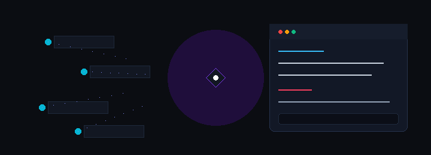
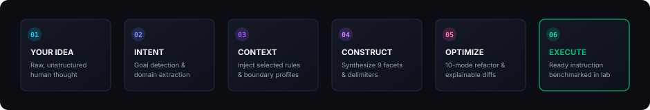
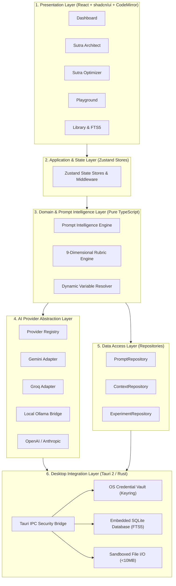

<div align="center">

<br />


<br />

### *"Where thoughts become instructions."*

**The Free, Local-First Desktop Prompt Engineering Environment**

<br />

[](https://tauri.app/)
[](https://react.dev/)
[](https://www.sqlite.org/)
[](https://tailwindcss.com/)
[](docs/product/ROADMAP.md)

<br />

[Architecture](ARCHITECTURE.md) • [Features](docs/product/FEATURE_SPECIFICATIONS.md) • [Roadmap](docs/product/ROADMAP.md) • [Documentation](docs/INDEX.md) • [Contributing](CONTRIBUTING.md)

<br />

<picture>
  <source srcset="docs/assets/readme/sutra-hero.svg" type="image/svg+xml">
  
</picture>

</div>

---

> [!NOTE]
> **Active Development Notice:** SUTRA.ai is currently in active pre-implementation development. Architectural specifications, database schemas, and engineering guidelines are fully established. Application source code and desktop installers are being implemented across the planned milestones in our [16-Week Roadmap](docs/product/ROADMAP.md).

---

## 1. Think Clearly. Prompt Intelligently.

The Sanskrit word **Sutra** (सूत्र) represents a *thread*, *aphorism*, *rule*, or *concise guiding instruction*. In classical literature, a sutra distilled profound, multifaceted human wisdom into the fewest possible, unshakeable words.

In modern artificial intelligence, **a prompt performs this exact role**. It serves as the instructional thread directing probabilistic foundation models toward reliable, deterministic, and high-performance outcomes.

Yet modern generative AI tools suffer from a fundamental mismatch: human thought is iterative, scattered, and contextual, whereas Large Language Models (LLMs) operate strictly on delimited token context windows and explicit attention constraints. When users under-specify their prompts, foundation models default to generic hallucinations.

**SUTRA.ai** is not a superficial prompt generator, "enhancer" wrapper, or SaaS subscription trap. It is an industrial-grade, **local-first Desktop Prompt Engineering Environment (PEE)**. SUTRA.ai bridges the gap between human intention and machine execution by transforming raw, unstructured thoughts into modular, role-bounded, constraint-governed prompts—with transparent explanations for every single modification.

---

## 2. The Core Experience

SUTRA.ai is structured into ten cohesive modules designed to support prompts across their entire lifecycle, from rough idea to production-ready instruction.

```
┌────────────────────────────────────────────────────────────────────────────────────────┐
│                                SUTRA.AI MODULE MATRIX                                  │
├──────────────────────────┬──────────────────────────┬──────────────────────────────────┤
│ 01. SUTRA Architect      │ 02. SUTRA Optimizer      │ 03. SUTRA Analyzer               │
│ Natural language to      │ 10 specialized modes with│ 9-dimensional rubric scoring     │
│ structured facet schema  │ explainable visual diffs │ & contradiction detection        │
├──────────────────────────┼──────────────────────────┼──────────────────────────────────┤
│ 04. SUTRA Playground     │ 05. SUTRA Library        │ 06. SUTRA Context Studio         │
│ Multi-model comparative  │ FTS5-indexed repository  │ Reusable domain rules & brand    │
│ benchmarking sandbox     │ with version history     │ profiles without silent leakage  │
├──────────────────────────┼──────────────────────────┼──────────────────────────────────┤
│ 07. SUTRA Workflow Studio│ 08. SUTRA Academy        │ 09. Workspace Dashboard          │
│ Node-based visual prompt │ Interactive prompt       │ Operational health, provider     │
│ chaining (Phase 8)       │ science curriculum       │ status & recent prompt metrics   │
├──────────────────────────┴──────────────────────────┴──────────────────────────────────┤
│ 10. Settings & Vault Management (Hardware OS Keyring & Local Ollama Discovery)         │
└────────────────────────────────────────────────────────────────────────────────────────┘
```

### Module Breakdown

| Module | Core Responsibility | Status |
| :--- | :--- | :---: |
| **SUTRA Architect** | Decomposes raw user thoughts into modular, model-adapted components: *Role, Primary Objective, Context, Numbered Instructions, Negative Constraints, Input Data Schema, Output Specification, and Self-Refinement Checks*. Features interactive clarification dialogs for underspecified requests. | `Planned` |
| **SUTRA Optimizer** | Refactors prompts across 10 specialized modes (*Enhance, Precision, Expand, Simplify, Technical, Creative, Research, Academic, Image Generation, Model Adaptation*). Generates inline side-by-side visual diffs and human-readable explanation logs. | `Planned` |
| **SUTRA Analyzer** | Evaluates prompt quality against a 9-dimensional rubric (*Clarity, Context, Specificity, Structure, Completeness, Constraints, Output Definition, Consistency, Readability*). Flags subtle contradictions and generates one-click remediation patches. | `Planned` |
| **SUTRA Playground** | Comparative execution sandbox running prompt variations across multiple models simultaneously (Gemini, Groq, OpenAI, Anthropic, and local Ollama) with latency (TTFT) and token telemetry. | `Planned` |
| **SUTRA Library** | Local-first prompt repository with infinite nested folders, tags, instant SQLite full-text search (FTS5), Mustache variable extraction (`{{var}}`), and immutable version history. | `Planned` |
| **SUTRA Context Studio** | Manages reusable project knowledge, coding standards, and brand rules. Users maintain explicit visual control over which context profiles attach to an outgoing prompt—zero silent data leakage. | `Planned` |
| **SUTRA Workflow Studio** | Visual node-based canvas for chaining multi-step AI reasoning pipelines (Research → Outline → Draft → Critique → Finalize). | `Phase 8` |
| **SUTRA Academy** | Interactive prompt engineering curriculum covering Few-shot calibration, Delimiter strategies, ReAct architectures, and Structured Output extraction with live grading labs. | `Phase 8` |
| **Home / Dashboard** | Workspace health hub displaying pinned prompts, recent experiments, database statistics, and live provider connection status. | `Planned` |
| **Settings & Providers** | OS-native hardware credential storage (Windows Credential Manager, macOS Keychain, Linux Secret Service), local Ollama discovery, and database backup tools. | `Planned` |

*For complete engineering specifications, review [docs/product/FEATURE_SPECIFICATIONS.md](docs/product/FEATURE_SPECIFICATIONS.md).*

---

## 3. How SUTRA Works

The Prompt Intelligence Engine combines local deterministic rules with semantic model reasoning, ensuring fast, cost-efficient, and explainable compilation:

<br />

<p align="center">
  
</p>

<br />

1. **Your Idea:** You provide a natural language goal, rough draft, or fragmented set of instructions.
2. **Intent Understanding:** The engine classifies your operational domain (coding, creative writing, data extraction, analysis) and primary objective.
3. **Context Analysis:** Active Context Studio profiles (coding conventions, brand rules) are assembled with real-time token previews. Missing critical parameters trigger targeted clarification questions.
4. **Prompt Construction:** The engine compiles the prompt into structured, delimited facets (`<role>`, `<objective>`, `<invariants>`, `<instructions>`), tailored to your target model's syntax quirks.
5. **Optimization & Rubric Evaluation:** The prompt is evaluated against the 9-dimensional rubric. Contradictions or ambiguities are flagged with explainable improvement rationales.
6. **Execution & Benchmarking:** The verified, high-performance instruction is ready for single-click execution in the Playground, export to your codebase, or version-controlled storage in your local Library.

---

## 4. Why SUTRA.ai?

```
┌────────────────────────────────────────────────────────────────────────────────────────┐
│                                 CORE VALUE PILLARS                                     │
├──────────────────────────┬──────────────────────────┬──────────────────────────────────┤
│ 🔒 Local-First Storage   │ ⚡ Provider Agnostic     │ 🔍 Explainable Refactoring       │
│ SQLite embedded database │ Google Gemini, Groq,     │ Side-by-side visual diffs with   │
│ on your physical machine │ OpenAI, Anthropic, Ollama│ exact rationale for every change │
├──────────────────────────┼──────────────────────────┼──────────────────────────────────┤
│ 🛡️ Hardware Vault Keys   │ 📊 9-Dimensional Rubric │ 💸 Free Core Experience          │
│ Keys stored in OS Keyring│ Objective prompt scoring │ Zero mandatory accounts, cloud   │
│ with zero telemetry      │ and contradiction scanner│ logins, or paywalled local tools │
└──────────────────────────┴──────────────────────────┴──────────────────────────────────┘
```

* **Local-First Data Ownership:** All prompts, collections, context profiles, and benchmark histories are stored in an encrypted/local SQLite database on your machine. Your proprietary instructions never touch a remote SUTRA server.
* **Complete Provider Independence:** SUTRA.ai connects seamlessly to **Google Gemini, Groq, OpenAI, Anthropic**, and offline local models via **Ollama**. Never get locked into a single model ecosystem.
* **Explainability Over Magic:** When SUTRA refactors or optimizes a prompt, it explains *why* a constraint was inserted, *what* ambiguity was removed, and *which* rubric principle guided the decision.
* **Hardware-Backed Credential Security:** API keys are never stored in plaintext JSON, `.env` files, or webview local storage. Keys are committed directly to your operating system's native credential manager (Windows Credential Manager, macOS Keychain, Linux Secret Service).
* **Zero Mandatory Subscriptions:** The core application is free, open, and fully functional offline. AI inference utilizes your own API keys or completely free, offline local models via Ollama.
* **Engineered for High-Density Focus:** Built with a dark-first, restrained desktop aesthetic inspired by Linear, Raycast, and Cursor. No visual clutter, no floating decorative cards, and non-blocking token streaming.

---

## 5. Technology Stack

SUTRA.ai is engineered with a high-performance, memory-safe desktop stack:

| Layer | Technology | Architectural Role | Status |
| :--- | :--- | :--- | :---: |
| **Desktop Runtime** | **Tauri 2 (Rust)** | Native OS integration, <60MB RAM footprint, hardened IPC security boundary | `Selected` |
| **Frontend Framework** | **React 18+ (TypeScript)** | Declarative UI, strict mode (`strict: true`), zero untyped `any` code | `Selected` |
| **Build Tooling** | **Vite** | Instant Hot Module Replacement (HMR) and optimized Rollup production bundling | `Selected` |
| **Design System** | **Tailwind CSS + shadcn/ui** | Accessible Radix UI primitives, dark-first charcoal substrates (`#0B0D12`) | `Selected` |
| **Motion & Micro-interactions** | **Framer Motion** | Physics-based micro-interactions and smooth panel expand/collapse transitions | `Selected` |
| **Client State** | **Zustand** | Outside-React selector access, transient streaming state isolation | `Selected` |
| **Local Persistence** | **SQLite (via Tauri SQL)** | ACID-compliant relational storage with sub-millisecond FTS5 search indexing | `Selected` |
| **Schema Validation** | **Zod** | Single source of truth for runtime validation and inferred TypeScript types | `Selected` |
| **Prompt Editors** | **CodeMirror 6 & Tiptap** | Custom delimiter syntax highlighting, token gutters, variable pills (`{{var}}`) | `Selected` |
| **Testing Harness** | **Vitest & Playwright** | Fast deterministic unit tests with in-memory `MockProvider`, cross-platform E2E | `Selected` |

*For deep architectural rationale and alternatives evaluated, see [docs/technical/TECH_STACK.md](docs/technical/TECH_STACK.md) and [ADR-0001](docs/decisions/ADR-0001-TECHNOLOGY-SELECTION.md).*

---

## 6. Architecture Overview

SUTRA.ai adheres to a strict six-layer decoupled architecture:



*Review the complete architectural specification in [ARCHITECTURE.md](ARCHITECTURE.md).*

---

## 7. Development Roadmap

Development executes across a structured 16-week timeline divided into six progressive phases:

| Phase | Timeline | Core Focus & Milestones | Status |
| :---: | :---: | :--- | :---: |
| **Phase 1** | **Weeks 1–3** | **Desktop Foundation & Shell:** Tauri 2 scaffolding, React + TypeScript setup, Tailwind design tokens, window chrome, and empty-state dashboard. | 🔄 `In Setup` |
| **Phase 2** | **Weeks 4–6** | **Prompt Engineering Core:** Structured facet model, deterministic parser, CodeMirror prompt editor, and interactive clarification questions. | 📋 `Planned` |
| **Phase 3** | **Weeks 7–9** | **AI Intelligence & Optimization:** Provider abstraction layer, Gemini, Groq, and Ollama adapters, 10 optimization modes, and visual diff engine. | 📋 `Planned` |
| **Phase 4** | **Weeks 10–12** | **Local Storage & Personalization:** SQLite migrations, FTS5 instant search, Prompt Library, version history, and Context Studio profiles. | 📋 `Planned` |
| **Phase 5** | **Weeks 13–14** | **Advanced Experimentation:** 9-dimensional rubric analyzer, comparative multi-pane Playground, and batch test fixture benchmarking. | 📋 `Planned` |
| **Phase 6** | **Weeks 15–16** | **Hardening & Production Release:** Security audits, Playwright E2E testing, WiX/NSIS Windows installers, DMG macOS bundles, and v1.0.0 distribution. | 📋 `Planned` |

*For week-by-week deliverables and learning goals, consult [docs/product/ROADMAP.md](docs/product/ROADMAP.md).*

---

## 8. Prerequisites & Development Setup

### System Requirements
* **Rust:** Stable 1.77+ with Cargo ([rustup.rs](https://rustup.rs/))
* **Node.js:** v18.0.0+ LTS or v20.0.0+ ([nodejs.org](https://nodejs.org/))
* **Package Manager:** `pnpm` (recommended) or `npm`
* **Platform Dependencies:**
  * **Windows:** Visual Studio Community with C++ build tools and WebView2 Runtime.
  * **macOS:** Xcode Command Line Tools (`xcode-select --install`).
  * **Linux:** `build-essential`, `libwebkit2gtk-4.1-dev`, `libgtk-3-dev`, `libssl-dev`, `libayatana-appindicator3-dev`.

### Planned Development Commands
*(Standardized scripts planned for Phase 1 initialization)*

```bash
# Clone the repository
git clone https://github.com/Gokul-555180/Sutra.ai.git
cd Sutra.ai

# Install frontend dependencies (Planned Phase 1)
pnpm install

# Launch Tauri desktop application in development mode with Hot Reload (Planned Phase 1)
pnpm tauri dev

# Run TypeScript type check with strict compiler
pnpm tsc --noEmit

# Run unit and rubric scoring test suite (Vitest)
pnpm test

# Run native Rust integration and migration tests
cargo test --manifest-path src-tauri/Cargo.toml

# Build production packaged desktop installer (Planned Phase 6)
pnpm tauri build
```

---

## 9. Project Status & Documentation Portal

SUTRA.ai is under active development. All foundational documentation, architectural contracts, and engineering instructions are published and maintained in this repository:

* 📖 **[Documentation Portal](docs/INDEX.md)** — Centralized index and role-based reading orders.
* 🏛️ **[Technical Architecture](ARCHITECTURE.md)** — Comprehensive 6-layer design specification.
* 🤖 **[Agent & Engineering Rules](AGENTS.md)** — Strict development invariants and coding standards.
* 📋 **[Product Requirements](docs/product/PRODUCT_REQUIREMENTS.md)** — Complete PRD, user personas, and requirement IDs.
* ⚙️ **[Feature Specifications](docs/product/FEATURE_SPECIFICATIONS.md)** — Detailed specifications for Modules 1 through 10.
* 🔄 **[Interactive User Flows](docs/product/USER_FLOWS.md)** — Step-by-step user journeys and Mermaid sequence diagrams.
* 🔒 **[Security & Vault Design](docs/technical/SECURITY_DESIGN.md)** — STRIDE threat model and OS Keyring integration.
* 🎨 **[Design System Specification](docs/design/DESIGN_SYSTEM.md)** — Semantic dark-first color tokens and typography.

---

## 10. Contributing

We welcome contributions from prompt engineers, desktop developers, and AI researchers who value craftsmanship, privacy, and architectural rigor.

1. Read our [Contributing Guide](CONTRIBUTING.md) for branch naming (`feat/`, `fix/`) and Conventional Commit standards.
2. Review our [Code of Conduct](CODE_OF_CONDUCT.md) for community participation principles.
3. Adhere strictly to the engineering rules in [AGENTS.md](AGENTS.md) regarding TypeScript strictness, component sizing (<250 lines), and deterministic testing.
4. For security-related inquiries, please consult our [Security Policy](SECURITY.md).

---

## 11. Closing Vision

<div align="center">

<br />

> *"Every great AI interaction begins with a better instruction."*

<br />

**SUTRA.ai**  
*"Where thoughts become instructions."*

<br />

[Documentation](docs/INDEX.md) • [Architecture](ARCHITECTURE.md) • [Roadmap](docs/product/ROADMAP.md) • [Issues](https://github.com/Gokul-555180/Sutra.ai/issues)

<br />

<sub>Built with architectural discipline for the global prompt engineering community.</sub>

</div>
