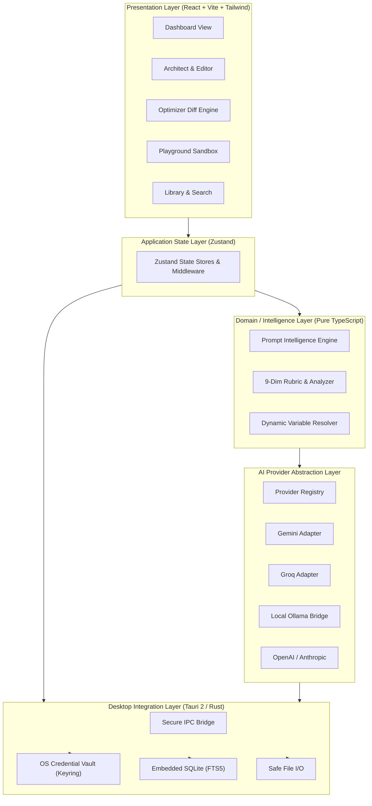

# SUTRA.ai

<div align="center">

```
   _____ _    _ _______ _____            _ 
  / ____| |  | |__   __|  __ \   /\     (_)
 | (___ | |  | |  | |  | |__) | /  \     _ 
  \___ \| |  | |  | |  |  _  / / /\ \   | |
  ____) | |__| |  | |  | | \ \/ ____ \ _| |
 |_____/ \____/   |_|  |_|  \/_/    \_(_)_|
```

### *"Where thoughts become instructions."*

**The Free, Local-First Desktop Prompt Engineering Environment**

[](https://tauri.app/)
[](https://www.rust-lang.org/)
[](https://react.dev/)
[](https://www.typescriptlang.org/)
[](https://tailwindcss.com/)
[](https://www.sqlite.org/)
[](#project-status--roadmap)

[Architecture Specification](ARCHITECTURE.md) • [Agent & Developer Guidelines](AGENTS.md) • [Feature Modules](#core-modules) • [Roadmap](#project-status--roadmap)

</div>

---

> [!NOTE]
> **Project Status:** SUTRA.ai is currently in early foundational development. The core specifications, architectural blueprints, and engineering standards are established. Application source code and release builds are actively in development across planned milestones.

---

## 1. Introducing SUTRA.ai

The word **Sutra** originates from Sanskrit (सूत्र), meaning a *thread*, *aphorism*, *rule*, or *concise guiding principle*. In ancient literature, a sutra distilled profound wisdom into the fewest possible, unshakeable words.

In modern artificial intelligence, **a prompt performs the exact same role**. It serves as the foundational thread that directs probabilistic foundation models toward reliable, high-performance outcomes.

**SUTRA.ai** is a free, local-first desktop application designed to help users construct, optimize, evaluate, benchmark, organize, and master AI prompts. It is not a superficial prompt wrapper or a simple "AI generator"—it is a complete, industrial-grade **Prompt Engineering Environment (PEE)** for:

* **Software Engineers & AI Builders:** Designing structured system instructions, JSON schema extractions, and zero-hallucination guardrails.
* **Researchers & Academics:** Enforcing methodological rigor, counter-argument mandates, and citation frameworks.
* **Prompt Engineers:** Benchmarking prompt variations across multiple models with live side-by-side latency and token analytics.
* **Content Creators & Designers:** Generating specialized image-generation keywords, camera angles, lighting cues, and creative prose constraints.
* **Professionals & Students:** Turning rough, unstructured ideas into polished, effective instructions without paying for SaaS subscriptions.

---

## 2. Core Highlights & Philosophy

| Principle | SUTRA.ai Approach |
| :--- | :--- |
| **Local-First Data Ownership** | Your prompts, context profiles, and experiment logs are stored in an embedded SQLite database on your physical machine. You own your data completely. |
| **AI Provider Independence** | Never lock yourself into a single vendor. SUTRA.ai connects seamlessly to **Google Gemini, Groq, OpenAI, Anthropic**, and local **Ollama** models. |
| **Explainable Optimization** | We do not treat prompt improvement as magic. When SUTRA optimizes a prompt, it explains exactly *why* a constraint was added, *what* ambiguity was removed, and *which* rubric principle guided the change. |
| **Objective Diagnostic Rubric** | Evaluate prompt quality using a transparent 9-dimensional rubric (Clarity, Specificity, Structure, Constraints, etc.) combining local deterministic rules with semantic AI checks. |
| **Zero Mandatory Subscriptions** | The core application is free and operates offline. AI inference utilizes your own API keys or completely free, offline local models via Ollama. |
| **Privacy & Zero Telemetry** | No tracking scripts, no behavioral telemetry, and no hidden server relays. Sensitive API keys are stored securely in your operating system's native credential vault. |
| **Premium Desktop Ergonomics** | Designed for sustained focus with a restrained, dark-first aesthetic inspired by world-class developer tools like Linear, Raycast, and Cursor. |

---

## 3. Product Feature Catalog

```
┌─────────────────────────────────────────────────────────────────────────────┐
│                            SUTRA.AI MODULE SUITE                            │
├──────────────────────┬──────────────────────┬───────────────────────────────┤
│ 1. Home / Dashboard  │ 2. Sutra Architect   │ 3. Sutra Optimizer            │
│    Workspace hub     │    Structured prompt │    10 specialized improvement │
│    & status metrics  │    creation engine   │    & adaptation modes         │
├──────────────────────┼──────────────────────┼───────────────────────────────┤
│ 4. Sutra Analyzer    │ 5. Sutra Playground  │ 6. Sutra Library              │
│    9-dimensional     │    Multi-model test  │    FTS5-indexed storage       │
│    diagnostic rubric │    & benchmark bench │    & version history          │
├──────────────────────┼──────────────────────┼───────────────────────────────┤
│ 7. Context Studio    │ 8. Workflow Studio   │ 9. Sutra Academy              │
│    Reusable project  │    Visual prompt     │    Interactive prompt         │
│    knowledge profiles│    chaining (Phase 8)│    engineering curriculum     │
├──────────────────────┴──────────────────────┴───────────────────────────────┤
│ 10. Settings & Provider Management (Keyring Vault, Ollama Discovery)        │
└─────────────────────────────────────────────────────────────────────────────┘
```

### Module Breakdown

1. **Home / Dashboard:** Instant situational awareness, pinned prompts, recent experiments, local database statistics, and live AI provider ping latency.
2. **SUTRA Architect:** Transforms natural language thoughts into structured prompt models (Role, Objective, Context, Numbered Instructions, Negative Constraints, Input Data Schema, Output Specifications).
3. **SUTRA Optimizer:** Multi-mode prompt refactoring across 10 specialized profiles (*Enhance, Precision, Expand, Simplify, Technical, Creative, Research, Academic, Image Generation, Model Adaptation*) with side-by-side diffing and rationale logs.
4. **SUTRA Analyzer:** Scans prompts for ambiguities, missing constraints, contradictory instructions, and token inefficiencies across a 9-dimensional scoring rubric.
5. **SUTRA Playground:** Side-by-side comparative sandbox executing Version A vs Version B across multiple cloud and local models with parameter controls (temperature, top_p) and latency/token tracking.
6. **SUTRA Library:** Local-first repository featuring infinite nested collections, tags, instant full-text search (FTS5), dynamic `{{variables}}`, and point-in-time version history.
7. **SUTRA Context Studio:** Reusable project context, brand guidelines, and coding standards that can be explicitly attached to prompts without silent leakage.
8. **SUTRA Workflow Studio:** Visual node-based prompt chaining for sequential multi-step AI reasoning pipelines *(Planned for Phase 8)*.
9. **SUTRA Academy:** Interactive, self-paced curriculum covering modern prompt science (Few-shot, Delimiters, ReAct, CoT, Structured JSON outputs).
10. **Settings & Provider Management:** Secure credential management (OS Keyring), dark/light themes, database backup/compaction, and local Ollama discovery.

---

## 4. Architectural Overview

SUTRA.ai utilizes a high-performance **Tauri 2 (Rust) + React (TypeScript)** desktop architecture.



For complete technical specifications, review [ARCHITECTURE.md](ARCHITECTURE.md).

---

## 5. Technology Stack

* **Desktop Runtime:** [Tauri 2](https://tauri.app/) (Rust 2021)
* **Frontend Framework:** [React 18+](https://react.dev/) with [TypeScript](https://www.typescriptlang.org/) (Strict Mode)
* **Build Tooling:** [Vite](https://vitejs.dev/)
* **UI & Styling:** [Tailwind CSS](https://tailwindcss.com/) with [shadcn/ui](https://ui.shadcn.com/)
* **Motion:** [Framer Motion](https://www.framer.com/motion/)
* **Icons:** [Lucide React](https://lucide.dev/)
* **State Management:** [Zustand](https://github.com/pmndrs/zustand)
* **Local Persistence:** [SQLite](https://www.sqlite.org/) via Tauri SQL plugin
* **Schema Validation:** [Zod](https://zod.dev/)
* **Prompt Editors:** [CodeMirror 6](https://codemirror.net/) (Prompt engineering, diffs, tokens) & [Tiptap](https://tiptap.dev/) (Rich structured prose)
* **AI Backends Supported:** Google Gemini, Groq, OpenAI, Anthropic, and local Ollama instances
* **Testing:** Vitest, React Testing Library, Playwright, and Cargo Test

---

## 6. Development Setup & Requirements

### System Prerequisites
To build and run SUTRA.ai from source once code development commences, the following prerequisites are required:

1. **Rust Toolchain:** Stable version 1.77+ with Cargo ([Install Rust](https://rustup.rs/))
2. **Node.js:** v18.0.0+ LTS or v20.0.0+ ([Install Node.js](https://nodejs.org/))
3. **Package Manager:** `pnpm` (recommended) or `npm`
4. **Platform-Specific Desktop Build Dependencies:**
   * **Windows:** Microsoft C++ Build Tools or Visual Studio Community with C++ desktop development workload, and WebView2.
   * **macOS:** Xcode Command Line Tools (`xcode-select --install`).
   * **Linux:** `libwebkit2gtk-4.1-dev`, `build-essential`, `curl`, `wget`, `file`, `libssl-dev`, `libgtk-3-dev`, `libayatana-appindicator3-dev`, `librsvg2-dev`.

### Planned Development Commands
*(Note: These commands represent the standardized build scripts planned for Phase 1 initialization).*

```bash
# 1. Clone the repository
git clone https://github.com/Gokul-555180/Sutra.ai.git
cd Sutra.ai

# 2. Install frontend dependencies (Planned Phase 1)
pnpm install

# 3. Launch Tauri desktop app in development mode with Hot Reload (Planned Phase 1)
pnpm tauri dev

# 4. Run frontend unit and domain rubric tests (Planned)
pnpm test

# 5. Run Rust backend integration and migration tests (Planned)
cargo test --manifest-path src-tauri/Cargo.toml

# 6. Build production desktop installer package (Planned Phase 9)
pnpm tauri build
```

---

## 7. Project Status & Roadmap

SUTRA.ai is structured into nine progressive, verifiable phases:

| Phase | Title | Focus & Core Deliverables | Status |
| :---: | :--- | :--- | :---: |
| **Phase 1** | **Foundation** | Tauri 2 setup, React/TS, Tailwind & shadcn/ui design tokens, window shell, SQLite setup | Planned |
| **Phase 2** | **Prompt Architect** | CodeMirror editor, structured prompt facet model, deterministic prompt generator | Planned |
| **Phase 3** | **AI Intelligence** | Provider abstraction layer, Gemini, Groq, Ollama adapters, streaming hooks | Planned |
| **Phase 4** | **Prompt Analysis** | 9-dimensional rubric engine, contradiction detector, visual score breakdown | Planned |
| **Phase 5** | **Local Storage** | SQLite repositories, Prompt Library, FTS5 instant search, version history, export | Planned |
| **Phase 6** | **Templates & Context** | Dynamic Mustache variables, Context Studio profiles, safe context injection | Planned |
| **Phase 7** | **Experimentation** | Playground comparative sandbox, multi-model testing, latency/token metrics | Planned |
| **Phase 8** | **Advanced Modules** | Visual Workflow Studio node graph, Academy curriculum, Anthropic/OpenAI | Planned |
| **Phase 9** | **Production Release** | Hardening, code signing, installers (`.msi`, `.dmg`), documentation wrap-up | Planned |

---

## 8. Contributing

Contributions are welcome from prompt engineers, desktop developers, and AI researchers.

To ensure consistency and quality:
1. Review [ARCHITECTURE.md](ARCHITECTURE.md) to understand the system design and layer boundaries.
2. Follow all guidelines in [AGENTS.md](AGENTS.md) regarding strict TypeScript typing, design aesthetics, security rules, and testing standards.
3. Open an issue on GitHub to discuss proposed architecture changes before submitting large PRs.

---

## 9. Issue Reporting & Support

If you encounter a bug, have an architectural suggestion, or want to propose a new prompt optimization mode:
* Open an issue at [GitHub Issues](https://github.com/Gokul-555180/Sutra.ai/issues).
* Provide detailed reproduction steps, target OS information, and relevant logs.

---

## 10. License & Disclaimers

### License
The open-source licensing model for SUTRA.ai is currently being finalized to ensure maximum accessibility for individual users while safeguarding the project's long-term independence. A formalized `LICENSE` file will be published prior to public binary releases.

### AI Disclaimer
Large Language Models produce probabilistic outputs. SUTRA.ai provides scientific frameworks, heuristic checks, and structured optimization tools to dramatically enhance prompt effectiveness, but cannot guarantee deterministic or hallucination-free outputs from underlying foundation models.
