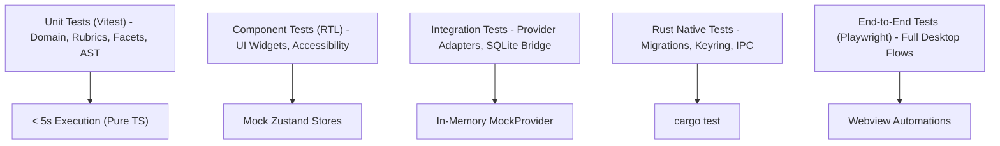

# SUTRA.ai — Comprehensive Testing Strategy

> **Document Version:** 1.0.0  
> **Status:** Active Testing Policy  
> **Target Audience:** QA Engineers, Software Developers, AI Agents  
> **Related Documents:** [DEVELOPMENT_GUIDE.md](DEVELOPMENT_GUIDE.md), [ARCHITECTURE.md](../../ARCHITECTURE.md), [AGENTS.md](../../AGENTS.md)

---

## 1. Testing Philosophy & CI Invariants

The integrity of SUTRA.ai rests on rigorous, reproducible testing:
1. **Deterministic CI Execution:** Continuous Integration test runs must **never make live network calls** to external paid AI APIs. All AI interactions must utilize the deterministic in-memory `MockProvider`.
2. **Strict Type Safety:** Type errors are treated as fatal build failures. `pnpm tsc --noEmit` must pass with 0 errors.
3. **No Flaky Tests:** Asynchronous tests must use deterministic wait conditions rather than arbitrary `setTimeout` delays.

---

## 2. Test Pyramid & Tooling Allocation

| Test Layer | Framework | Target Scope | Execution Cadence |
| :--- | :--- | :--- | :--- |
| **Domain Unit Tests** | Vitest | Facet extraction, rubric scoring math, Mustache variable interpolation, diff algorithms | Every git commit / pre-commit |
| **Component Tests** | React Testing Library | UI buttons, dialog focus traps, CodeMirror gutters, theme toggles, a11y ARIA attributes | Pre-push / CI pull requests |
| **Provider Tests** | Vitest + `MockProvider` | Adapters, normalizers, rate limit backoff retry loops, stream chunking | CI pull requests |
| **Database Tests** | Rust `cargo test` | SQLite migration sequences, FTS5 triggers, transaction rollbacks | CI pull requests |
| **Desktop E2E Tests** | Playwright | Complete user flows: Onboarding → Create Prompt → Optimize → Save to Library | Nightly / Pre-release |
| **Security Audits** | `pnpm audit` + `cargo audit` | Dependency vulnerability scans | Daily automated CI schedule |

---

## 3. Module-Specific Test Requirements

### Module 2: SUTRA Architect
* Unit tests verifying that raw inputs across 20+ test fixtures correctly extract Role, Objective, and Constraints.
* Edge-case verification: empty inputs, inputs containing prompt injection payloads, multi-lingual inputs.

### Module 3: SUTRA Optimizer
* Unit tests verifying that every one of the 10 optimization modes generates valid diff tokens and human-readable explanation items.
* Verification of undo/redo history stacks maintaining state immutability.

### Module 4: SUTRA Analyzer
* Unit test coverage for all 9 rubric dimensions across standardized benchmark prompts.
* Tests confirming that heuristic scores always produce clear disclaimers.
* Automated detection of explicit contradictions (e.g., "be extremely brief" vs "explain in exhaustive detail").

### Module 6: SUTRA Library
* Database tests ensuring SQLite FTS5 search queries return matching records in < 15ms across a test dataset of 10,000 synthetic prompts.
* Transaction rollback verification when importing corrupted JSON prompt bundles.
