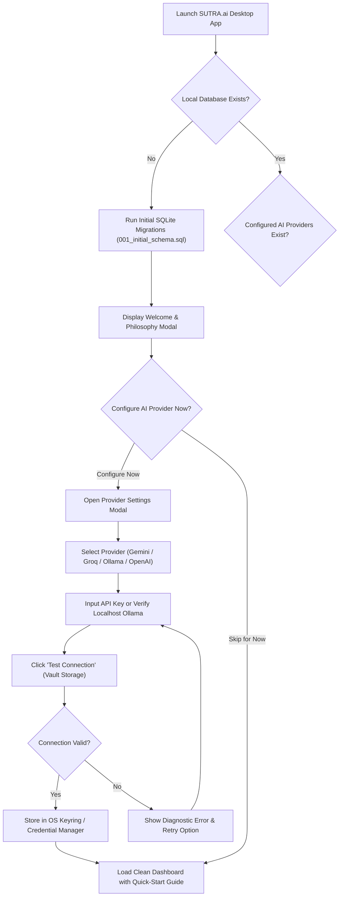
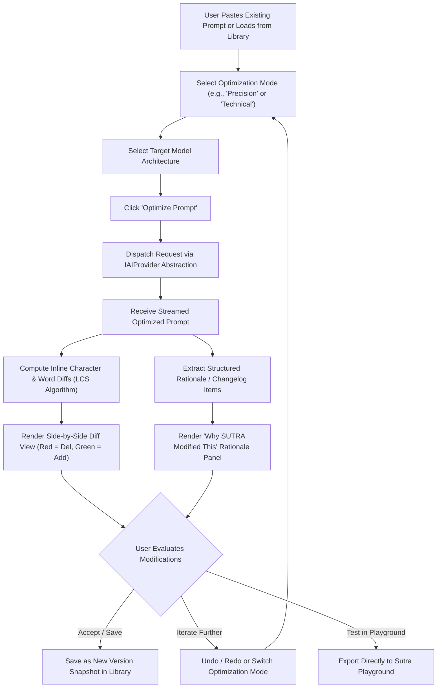
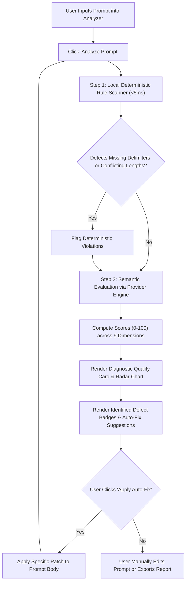
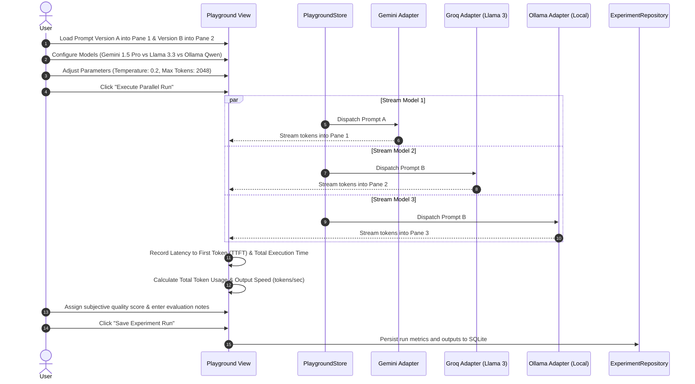
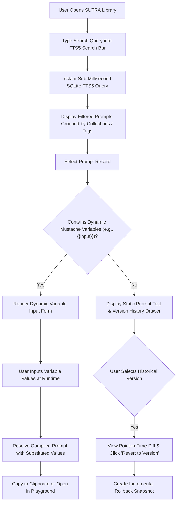
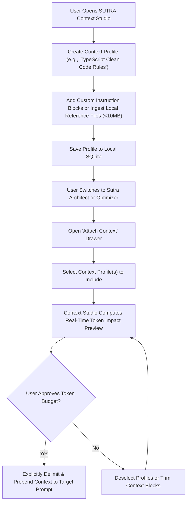
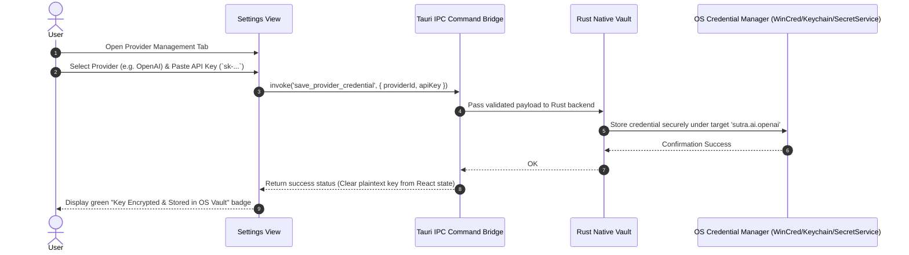

# SUTRA.ai — Comprehensive User Flows

> **Document Version:** 1.0.0  
> **Status:** Foundational Specification  
> **Related Documents:** [PRODUCT_REQUIREMENTS.md](PRODUCT_REQUIREMENTS.md), [FEATURE_SPECIFICATIONS.md](FEATURE_SPECIFICATIONS.md), [ARCHITECTURE.md](../../ARCHITECTURE.md)

This document visualizes and specifies the end-to-end user journeys through SUTRA.ai, detailing step-by-step user interactions, decision branches, system responses, and state transitions.

---

## 1. First-Time Onboarding Flow

When a user launches SUTRA.ai for the first time, the application provides an immediate zero-friction onboarding sequence without requiring account creation or cloud authentication.



---

## 2. Structured Prompt Creation Flow (SUTRA Architect)

The primary prompt authoring workflow guides the user from raw intention to a structured, model-adapted prompt.

```mermaid
sequenceDiagram
    autonumber
    actor User as User
    participant UI as Architect View
    participant Engine as Prompt Intelligence Engine
    participant LLM as Provider / Local Model
    participant Repo as PromptRepository

    User->>UI: Enter raw thought (e.g. "Python invoice parser")
    User->>UI: Select Domain (Coding) & Target Model (Claude 3.5)
    UI->>Engine: Parse input for structural facets
    Engine->>Engine: Run deterministic keyword & token scan
    
    opt Missing Critical Invariants
        Engine-->>UI: Return Clarification Questions (e.g. Input file type?)
        UI-->>User: Render Interactive Clarification Dialog
        User->>UI: Select options (PDF, structured JSON output)
        UI->>Engine: Send clarification payload
    end

    Engine->>LLM: Synthesize prompt facets (Role, Objective, Constraints)
    LLM-->>Engine: Return structured schema
    Engine->>Engine: Adapt delimiters (<instructions>, XML tags)
    Engine-->>UI: Populate CodeMirror editor with structured prompt
    User->>UI: Refine instructions or inject {{variables}}
    User->>UI: Click "Save to Library"
    UI->>Repo: Create Prompt & Version Snapshot in SQLite
    Repo-->>UI: Confirm save; display success toast
```

---

## 3. Explainable Optimization Flow (SUTRA Optimizer)

Demonstrates how users refactor existing prompts across 10 specialized modes with instant visual diffs and explainability logs.



---

## 4. Prompt Quality Analysis Flow (SUTRA Analyzer)

Scans a prompt against the 9-dimensional rubric, flagging ambiguities, missing constraints, and conflicting instructions.



---

## 5. Comparative Playground Experimentation Flow

Enables developers to empirically benchmark prompt variants across multiple foundational models in parallel.



---

## 6. Library Management & Dynamic Variable Injection Flow



---

## 7. Context Studio Knowledge Attachment Flow



---

## 8. Provider Configuration & Hardware Vault Security Flow


