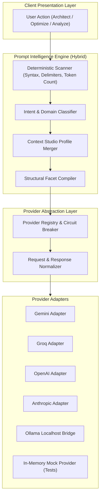
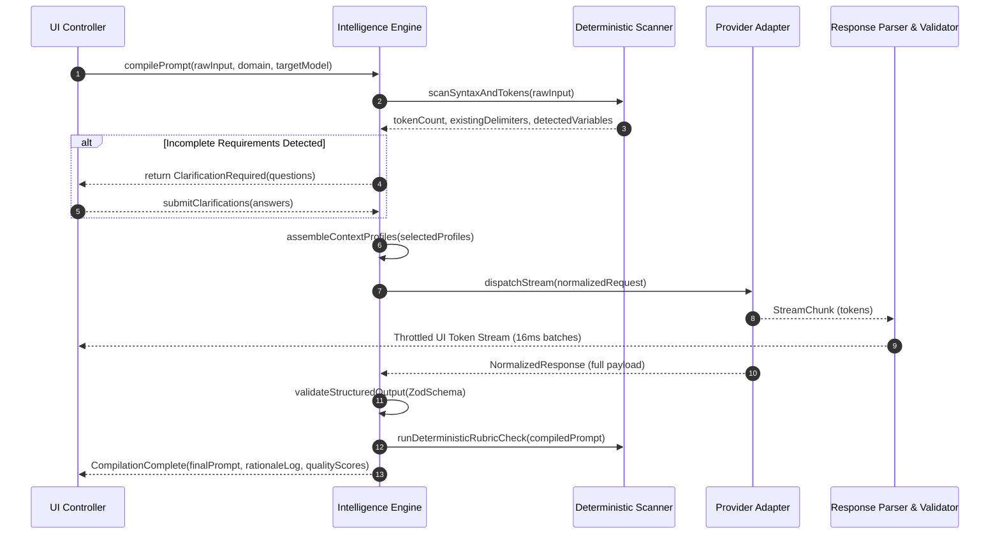
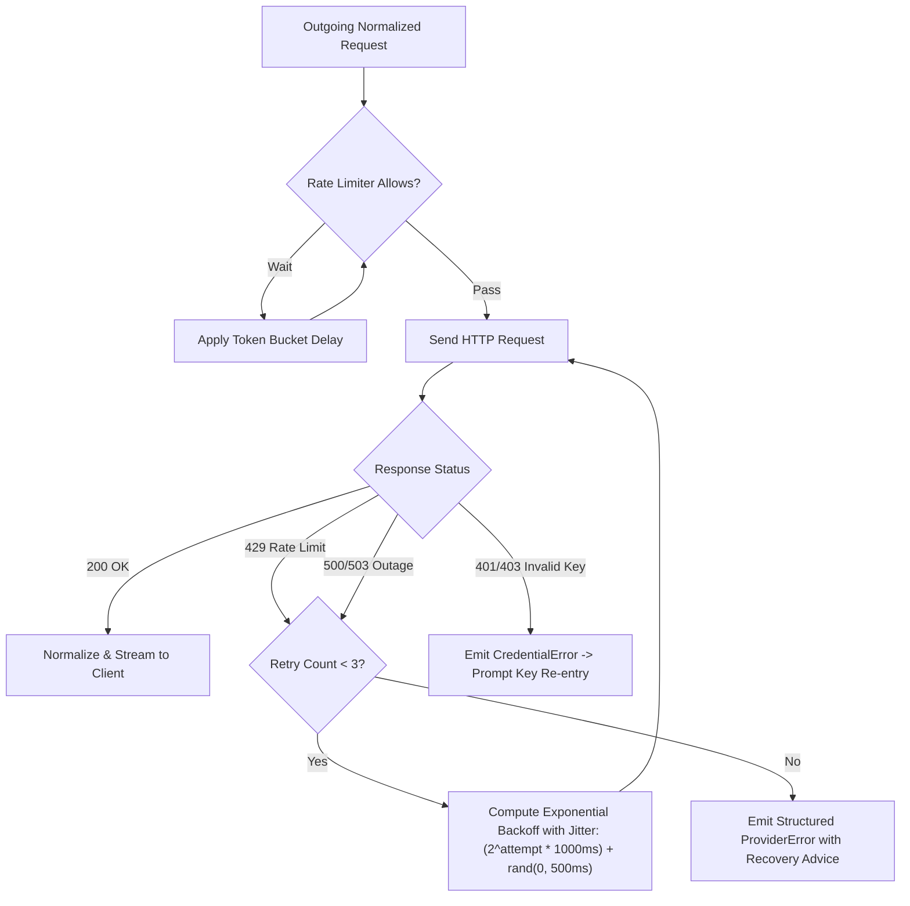

# SUTRA.ai — AI System Architecture & Intelligence Engine Design

> **Document Version:** 1.0.0  
> **Status:** Foundational Architecture  
> **Related Documents:** [ARCHITECTURE.md](../../ARCHITECTURE.md), [TECH_STACK.md](TECH_STACK.md), [API_DESIGN.md](API_DESIGN.md)

---

## 1. System Overview & Design Philosophy

The SUTRA.ai AI system is designed around three fundamental principles:
1. **Strict Vendor Neutrality:** The UI and domain logic interact exclusively with an abstract provider interface (`IAIProvider`). No vendor SDK is directly imported into presentation components.
2. **Hybrid Intelligence (Rules First, LLMs Second):** Operations that can be resolved deterministically (delimiter validation, token counting, missing format detection, keyword matching) are handled locally in Rust and TypeScript without incurring API latency or cost.
3. **Transparent Explainability:** Every automated optimization or restructuring must generate a human-readable changelog detailing why changes were made.



---

## 2. Prompt Intelligence Pipeline

When a user submits raw thoughts, the system processes them through a multi-stage compilation pipeline:



---

## 3. Provider Abstraction Architecture

### 3.1 Interface Contracts
Every AI backend implements the standardized `IAIProvider` interface:

```typescript
export interface ModelMetadata {
  id: string;
  name: string;
  providerId: 'gemini' | 'groq' | 'openai' | 'anthropic' | 'ollama' | 'mock';
  contextWindow: number;
  maxOutputTokens: number;
  supportsStreaming: boolean;
  supportsJsonSchema: boolean;
  supportsVision: boolean;
  isLocal: boolean;
}

export interface NormalizedRequest {
  model: string;
  systemInstruction?: string;
  messages: Array<{
    role: 'user' | 'assistant' | 'system';
    content: string;
  }>;
  temperature?: number;
  maxTokens?: number;
  topP?: number;
  stopSequences?: string[];
  responseFormat?: 'text' | 'json';
}

export interface StreamChunk {
  delta: string;
  rawChunk?: unknown;
}

export interface NormalizedResponse {
  content: string;
  rawUsage: {
    promptTokens: number;
    completionTokens: number;
    totalTokens: number;
  };
  finishReason: 'stop' | 'length' | 'content_filter' | 'error';
  latencyMs: number;
}

export interface IAIProvider {
  readonly id: string;
  readonly name: string;
  readonly supportedModels: ModelMetadata[];

  initialize(credentials?: string, endpoint?: string): Promise<void>;
  complete(request: NormalizedRequest): Promise<NormalizedResponse>;
  stream(request: NormalizedRequest): AsyncIterable<StreamChunk>;
  countTokens(text: string, model: string): number;
  validateCredentials(): Promise<boolean>;
}
```

---

## 4. Resilience, Rate Limiting & Error Handling

To provide industrial stability when interacting with external cloud APIs:



### 4.1 Error Recovery Protocols
* **HTTP 429 (Rate Limit Exceeded):** Automatically pauses and retries using jittered exponential backoff (attempt 1: ~1s, attempt 2: ~2s, attempt 3: ~4s). If all retries fail, UI displays exact reset time and suggests switching to Groq or local Ollama.
* **HTTP 401 / 403 (Invalid / Expired Key):** Clears the cached session key and surfaces an in-app credential prompt with direct link to provider key generation pages.
* **Network Partition / Timeout:** Hard 45-second timeout for non-streaming requests; graceful interruption controls for active streams.

---

## 5. Local Model Execution (Ollama Integration)

SUTRA.ai includes native support for offline, private AI execution via Ollama:
* **Auto-Discovery:** At startup or on user refresh, the application checks `http://localhost:11434/api/tags`.
* **Dynamic Model Ingestion:** Any locally pulled model (e.g., `llama3.3:latest`, `deepseek-r1:14b`, `qwen2.5-coder:7b`) is dynamically registered into `ProviderRegistry` as an active model.
* **Zero Internet Required:** Prompts routed to Ollama execute 100% locally with zero external network packets.

---

## 6. Testing Strategy & Mock Provider Architecture

Automated CI runs must never depend on live paid APIs or external internet connections.

### In-Memory Mock Provider
An in-memory `MockProvider` ships in `src/providers/adapters/mock.ts`:
* Supports canned responses, simulated network latency, and configurable streaming chunk sizes.
* Can simulate failure branches: rate limits (429), malformed JSON payloads, context window overflows, and connection timeouts.
* Used across all Vitest integration test suites to verify UI and domain behavior deterministically.
