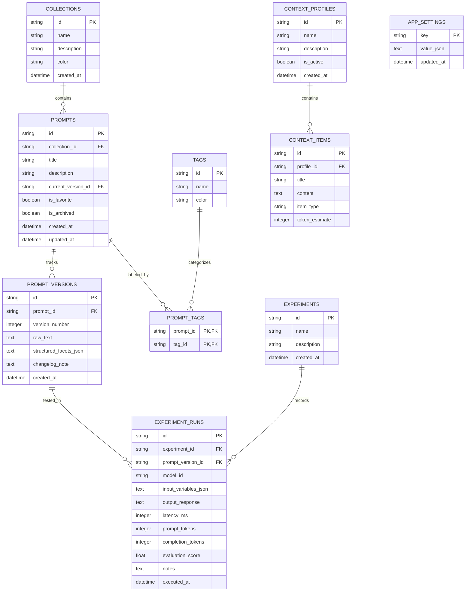

# SUTRA.ai — Local Relational Database Architecture

> **Document Version:** 1.0.0  
> **Status:** Foundational Architecture  
> **Database Engine:** Embedded SQLite 3 (via Tauri SQL Bridge)  
> **Related Documents:** [ARCHITECTURE.md](../../ARCHITECTURE.md), [AI_SYSTEM_DESIGN.md](AI_SYSTEM_DESIGN.md), [SECURITY_DESIGN.md](SECURITY_DESIGN.md)

---

## 1. Database Philosophy & Design Principles

SUTRA.ai relies on an embedded **SQLite** database (`sutra.db`) stored within the user's local application data directory.

```
┌─────────────────────────────────────────────────────────────────────────────┐
│                       SQLITE ARCHITECTURAL INVARIANTS                       │
├──────────────────────────┬──────────────────────────┬───────────────────────┤
│ 1. Local-First Ownership │ 2. Strict Foreign Keys   │ 3. Atomic Migrations  │
│    Zero cloud syncing;   │    PRAGMA foreign_keys=ON│    All schema changes │
│    user owns physical DB │    cascades avoid orphans│    execute in versioned│
│    file.                 │                          │    SQL transactions.  │
├──────────────────────────┴──────────────────────────┴───────────────────────┤
│ 4. Sub-Millisecond Search: Indexed with SQLite FTS5 Virtual Tables          │
└─────────────────────────────────────────────────────────────────────────────┘
```

---

## 2. Entity Relationship Diagram (ERD)



---

## 3. Detailed Table Schema Definitions

### MVP Tables (Phase 1–5)

#### 1. `collections`
* **Purpose:** High-level logical grouping for prompts (e.g., "Work", "Personal", "Research").
* **Columns:**
  * `id` TEXT PRIMARY KEY (UUID v4)
  * `name` TEXT NOT NULL
  * `description` TEXT
  * `color` TEXT DEFAULT '#7C3AED'
  * `created_at` DATETIME DEFAULT CURRENT_TIMESTAMP

#### 2. `prompts`
* **Purpose:** Core prompt entity representing a prompt concept and metadata.
* **Columns:**
  * `id` TEXT PRIMARY KEY (UUID v4)
  * `collection_id` TEXT REFERENCES `collections`(`id`) ON DELETE SET NULL
  * `title` TEXT NOT NULL
  * `description` TEXT
  * `current_version_id` TEXT
  * `is_favorite` BOOLEAN DEFAULT 0
  * `is_archived` BOOLEAN DEFAULT 0
  * `created_at` DATETIME DEFAULT CURRENT_TIMESTAMP
  * `updated_at` DATETIME DEFAULT CURRENT_TIMESTAMP
* **Indexes:** `idx_prompts_updated_at`, `idx_prompts_collection_id`

#### 3. `prompt_versions`
* **Purpose:** Immutable revision snapshots for every prompt save or optimization cycle.
* **Columns:**
  * `id` TEXT PRIMARY KEY (UUID v4)
  * `prompt_id` TEXT NOT NULL REFERENCES `prompts`(`id`) ON DELETE CASCADE
  * `version_number` INTEGER NOT NULL
  * `raw_text` TEXT NOT NULL
  * `structured_facets_json` TEXT NOT NULL (JSON string of Role, Objective, Constraints)
  * `changelog_note` TEXT
  * `created_at` DATETIME DEFAULT CURRENT_TIMESTAMP
* **Constraints:** `UNIQUE(prompt_id, version_number)`

#### 4. `tags` & `prompt_tags`
* **Purpose:** Many-to-many cross-cutting categorization taxonomy.
* **Columns (`tags`):** `id` TEXT PRIMARY KEY, `name` TEXT UNIQUE NOT NULL, `color` TEXT
* **Columns (`prompt_tags`):** `prompt_id` TEXT REFERENCES `prompts`(`id`) ON DELETE CASCADE, `tag_id` TEXT REFERENCES `tags`(`id`) ON DELETE CASCADE, `PRIMARY KEY(prompt_id, tag_id)`

#### 5. `context_profiles` & `context_items`
* **Purpose:** Reusable domain context and instruction snippets.
* **Columns (`context_profiles`):** `id` TEXT PRIMARY KEY, `name` TEXT NOT NULL, `description` TEXT, `is_active` BOOLEAN DEFAULT 1, `created_at` DATETIME
* **Columns (`context_items`):** `id` TEXT PRIMARY KEY, `profile_id` TEXT REFERENCES `context_profiles`(`id`) ON DELETE CASCADE, `title` TEXT NOT NULL, `content` TEXT NOT NULL, `item_type` TEXT NOT NULL, `token_estimate` INTEGER DEFAULT 0

#### 6. `experiments` & `experiment_runs`
* **Purpose:** Playground comparative execution runs and benchmarking telemetry.
* **Columns (`experiments`):** `id` TEXT PRIMARY KEY, `name` TEXT NOT NULL, `description` TEXT, `created_at` DATETIME
* **Columns (`experiment_runs`):** `id` TEXT PRIMARY KEY, `experiment_id` TEXT REFERENCES `experiments`(`id`) ON DELETE CASCADE, `prompt_version_id` TEXT REFERENCES `prompt_versions`(`id`) ON DELETE SET NULL, `model_id` TEXT NOT NULL, `input_variables_json` TEXT, `output_response` TEXT NOT NULL, `latency_ms` INTEGER NOT NULL, `prompt_tokens` INTEGER NOT NULL, `completion_tokens` INTEGER NOT NULL, `evaluation_score` REAL, `notes` TEXT, `executed_at` DATETIME

#### 7. `app_settings`
* **Purpose:** Application configuration (theme, default provider, active shortcuts).
* **Columns:** `key` TEXT PRIMARY KEY, `value_json` TEXT NOT NULL, `updated_at` DATETIME

---

## 4. Full-Text Search (FTS5) Virtual Table

To enable instant sub-millisecond search across tens of thousands of prompts:

```sql
CREATE VIRTUAL TABLE prompts_fts USING fts5(
    prompt_id UNINDEXED,
    title,
    description,
    raw_text,
    content='prompt_versions',
    content_rowid='rowid'
);
```

Database triggers automatically keep `prompts_fts` synchronized whenever a new prompt version is inserted.

---

## 5. Migration Strategy & Backup Protocol

1. **Sequential SQL Files:** Migrations live in `src-tauri/src/db/migrations/`:
   * `001_initial_schema.sql`
   * `002_context_and_experiments.sql`
   * `003_fts5_indexing.sql`
2. **Transactional Migrations:** At startup, Tauri inspects a `_schema_migrations` table. Unapplied scripts run inside an explicit transaction (`BEGIN TRANSACTION ... COMMIT`).
3. **Database Backup:** Users can trigger an instant SQLite vacuum backup (`VACUUM INTO ?`) to export their entire database without stopping active queries.
