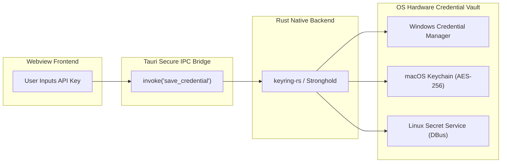

# SUTRA.ai — Security Architecture & Threat Model

> **Document Version:** 1.0.0  
> **Status:** Foundational Architecture  
> **Related Documents:** [SECURITY.md](../../SECURITY.md), [ARCHITECTURE.md](../../ARCHITECTURE.md), [TECH_STACK.md](TECH_STACK.md)

---

## 1. Threat Modeling & Security Posture

Prompt engineering environments handle high-value assets: proprietary system instructions, intellectual property, unreleased product specs, and paid API credentials. SUTRA.ai adopts a **Zero-Surveillance, Defense-in-Depth** model designed to resist both local malware inspection and external supply-chain attacks.

```
┌─────────────────────────────────────────────────────────────────────────────┐
│                      SUTRA.AI THREAT TAXONOMY (STRIDE)                      │
├─────────────────────┬───────────────────────────────────────────────────────┤
│ Threat Category     │ Architectural Countermeasure & Defense                │
├─────────────────────┼───────────────────────────────────────────────────────┤
│ Spoofing            │ Hardware-backed OS Keyring credential verification.   │
│ Tampering           │ Read-only bundle signatures, SQLite integrity checks. │
│ Repudiation         │ Immutable prompt revision history with local hashes.  │
│ Information Leakage │ Zero analytics, memory-only key lifecycle, local DB.  │
│ Denial of Service   │ File import size limits (<10MB), streaming throttles. │
│ Elevation of Priv.  │ Tauri 2 capability whitelisting, zero shell execution.│
└─────────────────────────────────────────────────────────────────────────────┘
```

---

## 2. Hardware Credential Vault Architecture

API keys for Google Gemini, Groq, OpenAI, and Anthropic are never stored in plaintext SQLite records, configuration JSON files, or webview local storage.



### In-Memory Lifecycle & Hygiene
* Keys are fetched from the native vault **only when an active HTTP request is created**.
* Keys are held in transient memory solely for the lifespan of that request and are immediately zeroized.
* Application crashes or unhandled exceptions trigger custom panic hooks that flush volatile memory buffers.

---

## 3. Desktop Runtime Sandboxing (Tauri 2 Capabilities)

SUTRA.ai disables all dangerous Tauri APIs by default:
* **Shell Command Execution (`tauri:shell`):** Disabled completely. The frontend cannot execute terminal commands, batch scripts, or background binaries.
* **Open-Ended File Browsing (`tauri:fs`):** Scoped strictly to application data directories and user-selected file paths returned by native OS dialogs.
* **HTTP Origin Isolation:** External HTTP requests from the frontend webview are restricted strictly to whitelisted provider domains (`*.googleapis.com`, `*.groq.com`, `*.openai.com`, `*.anthropic.com`, and `localhost:11434`).

---

## 4. Input Sanitization & Safe File Ingestion

1. **Size Limits:** User-imported context files (`.txt`, `.md`, `.pdf`) are capped at a maximum of **10 MB** to prevent memory exhaustion and Denial of Service.
2. **Encoding Verification:** File readers enforce strict UTF-8 validation. Files containing binary executable headers or malformed character sequences are rejected.
3. **Path Traversal Shield:** Filenames and paths undergo strict canonicalization to block directory traversal attacks (`../`, `..\`).

---

## 5. Logging, Privacy & User Consent

* **Zero Telemetry Guarantee:** SUTRA.ai does not include Google Analytics, PostHog, Mixpanel, Sentry, or any third-party tracking scripts.
* **Console Cleansing:** Production builds strip all `console.log` statements via Rollup build hooks.
* **Explicit User Initiation:** Cloud LLM calls are never triggered automatically in the background. Every inference request requires explicit user action (button click or shortcut).
